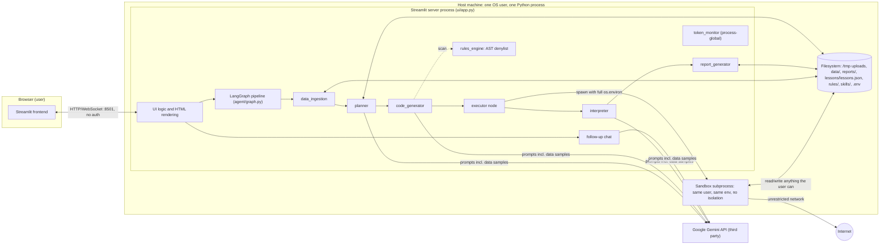
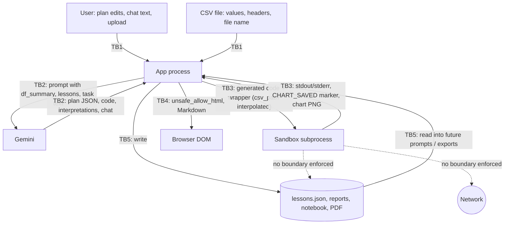

# InsightPilot: threat model (P1)

**Scope:** InsightPilot V1 as merged on `feature/insightpilot-v2` @ `6152da3a`. The application code is identical to the examination snapshot (`main` / `exam-backup-2026-11-17` @ `fd5783c6`).

**Status:** documentation only. Nothing here changes behaviour.

**Finding IDs** (`R-xx`, `F-xx`) refer to [risk_register.md](risk_register.md). Attack walk-throughs are in [abuse_cases.md](abuse_cases.md); the UI rendering inventory is in [html_render_audit.md](html_render_audit.md).

## 1. System overview

InsightPilot is a single-process Streamlit app.

- A user uploads a CSV (or picks a demo dataset).
- A LangGraph pipeline profiles it, asks Gemini for an analysis plan, waits for approval in the UI, asks Gemini to write pandas code for each task, and runs that code in a Python subprocess.
- Gemini then interprets the output; the app writes Markdown, PDF and notebook reports and answers follow-up questions.
- Deterministic "lessons" from each run are stored on disk and fed into later plans.

## 2. Data flow and trust boundaries

| Boundary | Between | Enforced today | Gap (finding) |
|---|---|---|---|
| **TB1** User / data → app | Browser upload, text inputs | Streamlit XSRF protection (default on); `.csv` type filter | No auth, binds all interfaces (R-18); file name unsanitised (R-06, R-07); no size or shape limits (R-16) |
| **TB2** App ↔ LLM | Prompts and responses | Plan JSON parsed and fields defaulted (`planner.py:60-94`) | Data and instructions not separated (R-10); output trusted as code and HTML (R-12, R-13); no task cap (R-16) |
| **TB3** App ↔ generated code | Subprocess | 30 s timeout; AST denylist; separate process | Same user, same environment, no FS/network/resource isolation (R-02 to R-05, R-17); wrapper interpolation (R-06); stdout trusted (R-20) |
| **TB4** App → browser | HTML rendering | `html.escape` in `df_preview_html` and `md_inline` | 15 sites insert untrusted text unescaped (R-13; XSS not demonstrated); Markdown in status messages (R-22) |
| **TB5** Persistent stores | Lessons, reports, exports | `.gitignore` for outputs; LESSONS_DIR override for tests | Free-text lessons re-enter prompts (R-11); exports leak paths and contain unsandboxed code (R-14, R-15) |
| **TB6** Source repository | Public GitHub | `.env` ignored *now* | Credential in history (R-01) |

## 3. Assets

| Asset | Where | Why it matters |
|---|---|---|
| Gemini API key | `.env` → `os.environ` (`utils/llm.py:13`); **git history** | Quota and billing; R-01, R-02 |
| User datasets | `/tmp/{name}`, `data/` | May contain personal or company data; sent in part to Gemini (R-14) |
| Exam demo material | `data/*.csv`, `reports/`, repository files | The examination depends on them; writable by generated code (R-04) |
| Application code and prompts | `agent/`, `ui/`, `rules/`, `skills/` | Integrity of every future run; writable by generated code (R-04, R-23) |
| Lesson store | `lessons/lessons.json` | Steers all future planning (R-11) |
| Approval decision | UI session state only | The only human control before code runs (R-08, R-09) |
| Reports and exports | `reports/*.md`, `.pdf`, `.ipynb` | Leave the machine; may carry paths, data and code (R-14, R-15) |
| Host availability | CPU, memory, disk of the laptop | The live demo (R-16, R-17) |

## 4. Entry points

| # | Entry point | Code | Attacker-controlled content |
|---|---|---|---|
| E1 | CSV upload | `ui/app.py:801-807` | File name, header names, cell values, size |
| E2 | Demo dataset buttons | `ui/app.py:810-821` | None (trusted repository files), unless modified through R-04 |
| E3 | Plan edit text | `ui/app.py:1018-1034` | Free text that reaches the planner and the lesson store |
| E4 | Follow-up chat | `ui/app.py:724-733, 1216, 1369` | Free text that reaches the chat prompt and HTML (R-13) |
| E5 | Settings toggle and slider | `ui/app.py:824-826` | Disables approval (R-08); raises retries (R-16) |
| E6 | LLM responses | all nodes | Plan, code, interpretations, chat (untrusted model output) |
| E7 | Sandbox output | `sandbox/executor.py:123-143` | stdout, stderr, chart marker; fully controlled by generated code |
| E8 | Lesson store | `agent/reflection_engine.py:136-169` | Anything written earlier (R-11) |
| E9 | Raw HTTP to Streamlit | Streamlit server | Crafted multipart upload names (R-07); anyone on the network (R-18) |
| E10 | Repository / dependencies | `requirements.txt`, `venv/`, `rules/`, `skills/` | Supply chain (R-23); public history (R-01) |

## 5. Attacker profiles

| Profile | Capabilities | Main paths |
|---|---|---|
| **A1 Malicious dataset author** | Crafts a CSV and file name the user uploads | R-10 → generated code → R-02 to R-05; R-06; R-13 (header names); R-11 (persists) |
| **A2 Network-adjacent user** | Reaches port 8501 on the same LAN, for example exam or college Wi-Fi | Uses the app and the key quota; crafted upload names (R-07); cross-session collisions (R-18) |
| **A3 Internet observer** | Reads the public GitHub repository | Credential in history (R-01) |
| **A4 Compromised or misbehaving model** | Returns arbitrary plan, code or prose | Same as A1 from TB2 onwards; R-12, R-13, R-16 |
| **A5 Local user / curious operator** | Uses the UI normally | Turns safe mode off (R-08); edits plan (R-09, R-11) |
| **A6 Future multi-agent component** | A V2 agent forwarding untrusted content | F-01 to F-08 |

Out of scope: attacks on Google's infrastructure, physical access to the laptop, and malicious OS-level software already running on the host.

## 6. STRIDE analysis

| Category | Threat | Component | Finding | Status |
|---|---|---|---|---|
| **S**poofing | Anyone on the network acts as the user (no authentication) | Streamlit server | R-18 | Confirmed-code |
| S | Generated stdout claims a chart path it did not create | executor | R-20 | Confirmed-code |
| S | A future agent impersonates another or forges approval | P7/P8 | F-01, F-05 | Future |
| **T**ampering | Generated code overwrites app code, rules, skills, datasets, lessons | sandbox | R-04 | Confirmed-test |
| T | Lesson store poisoned with persistent instructions | reflection | R-11 | Confirmed-code |
| T | Upload name writes outside `/tmp`; report paths traverse | UI, report | R-07 | Confirmed-code |
| T | LLM task id writes a chart outside `charts/` | executor | R-19 | Confirmed-test |
| T | User approves plan A, plan B runs | UI approval | R-09 | Confirmed-code |
| **R**epudiation | No record of who approved what, when, for which plan | UI approval | R-09 | Confirmed-code |
| R | Sandbox violations are not logged with the offending snippet, though the rules require it (`rules/sandbox_safety.rules.md:36-38`) | executor | R-24 | Confirmed-code |
| **I**nformation disclosure | API key in public git history | repository | R-01 | Confirmed (presence) |
| I | API key readable by generated code | sandbox | R-02 | Confirmed-test |
| I | Arbitrary file read; network exfiltration | sandbox | R-04, R-05 | Confirmed-test |
| I | Tracebacks, paths, data excerpts in UI and exports; samples sent to Gemini | UI, report | R-14 | Confirmed-code |
| I | Cross-session reuse of chart, report and upload files | shared state | R-18 | Confirmed-code |
| S / I | Untrusted text inserted **unescaped** into UI HTML (15 sites), enabling spoofed UI or remote-image beacons *if* the browser renders it | UI | R-13 | Confirmed-code (unescaped insertion); rendering not verified |
| I | Remote-image beacons through Markdown in status messages | UI | R-22 | Plausible |
| E | Browser-executable XSS through injected markup | UI | R-13 | **Not demonstrated**: no payload executed; sanitisation unknown |
| **D**enial of service | Memory, disk or process exhaustion by generated code | sandbox | R-17 | Confirmed-test (memory) |
| D | Unbounded tasks, retries, prompt growth and provider back-off | planner, LLM client | R-16 | Confirmed-code |
| D | Malformed markup aborts PDF export | report | R-21 | Plausible |
| **E**levation of privilege | Arbitrary code execution as the app user through scanner bypass | sandbox | R-03 | Confirmed-test |
| E | File-name code injection into the unscanned wrapper | sandbox wrapper | R-06 | Confirmed-test |
| E | Indirect prompt injection steers code generation | prompts | R-10 | Confirmed-code / Plausible |
| E | Approval gate bypass (graph or toggle) | graph | R-08 | Confirmed-test |
| E | Exported notebook runs LLM code with full user privileges | export | R-15 | Confirmed-code |

## 7. Security assumptions and deployment limitations

- **A-1. Single trusted operator.** V1 is safe to use only on the operator's own machine, bound to localhost, with datasets they trust. **Do not present it on a shared network without `--server.address 127.0.0.1`** (R-18).
- **A-2. Generated code is untrusted.** The project's own rules say so (`rules/sandbox_safety.rules.md:4`), but V1 gives it the same privileges as the app (R-02 to R-05). The AST scan only stops *naive* misuse.
- **A-3. The model is not a security boundary.** Prompt-level rules (`rules/*.md`) shape behaviour but cannot be relied on against crafted input (R-10, R-12).
- **A-4. Dataset content is untrusted**, including header names and the file name.
- **A-5. The LLM provider receives data.** Five sample rows, column names, statistics and model outputs go to Google (R-14). Real personal or company data needs the owner's consent and provider terms review.
- **A-6. Platform.** Assessed on Linux with the exam package pins. macOS behaviour (rlimits, `/tmp` → `/private/tmp`, browser rendering) is not verified; see `docs/v2/BASELINE.md`.
- **A-7. Third-party behaviour not validated here:**
  - whether Streamlit renders or sanitises injected markup in `unsafe_allow_html` content, and therefore whether browser-executable XSS is possible (R-13: unescaped insertion confirmed, XSS not demonstrated);
  - Markdown image rendering in `st.info` (R-22);
  - ReportLab tag handling (R-21);
  - Gemini's susceptibility to the injection corpus (R-10).

## 8. Existing versus missing controls

| Control | Status in V1 | Evidence | Gap / finding |
|---|---|---|---|
| Subprocess separation | ✅ present | `sandbox/executor.py:115` | Same user and environment (R-02, R-03) |
| Wall-clock timeout (30 s) | ✅ present | `sandbox/executor.py:17, 145-146` | No memory, CPU, disk or PID limits (R-17) |
| AST scan before execution | ⚠️ partial | `agent/rules_engine.py:109-153`; P0 passing tests | Denylist only; bypassable (R-03); wrapper not scanned (R-06) |
| Fail closed on scan violation | ✅ present | `sandbox/executor.py:102-104`; `test_unsafe_generated_code_is_blocked_and_never_executes` | Offending snippet not logged (R-24) |
| Environment and secret isolation | ❌ missing | `sandbox/executor.py:120` | R-02 |
| Filesystem confinement | ❌ missing | none | R-04 |
| Network isolation | ❌ missing | none | R-05 |
| Plan approval before execution | ⚠️ UI-only | `ui/app.py:948-966`; `graph.py:73, 99` | R-08; scope gaps R-09 |
| Approval audit trail | ❌ missing | none | R-09 |
| Prompt data/instruction separation | ❌ missing | `planner.py`, `code_generator.py` | R-10, R-12 |
| Plan schema validation | ⚠️ partial | defaults only (`planner.py:73-92`) | No task cap, id format, type allowlist (R-16, R-19) |
| Output escaping in UI | ⚠️ partial | `df_preview_html`, `md_inline` | 15 unescaped sites (R-13) |
| Path scrubbing for display | ⚠️ partial | `clean_detail` (`ui/app.py:647-652`) | Display only; exports unscrubbed (R-14) |
| Lesson validation and provenance | ❌ missing | `reflection_engine.py:121-133` | R-11 |
| Secrets out of the repository | ⚠️ partial | `.gitignore:2` | Historical commit (R-01); no scanning gate |
| Authentication and bind address | ❌ missing | no `.streamlit/config.toml` | R-18 |
| Per-session isolation of outputs | ❌ missing | shared `/tmp`, `reports/`, `lessons/`, global monitor | R-18 |
| Usage and budget limits | ⚠️ partial | rate-limit retry (`utils/llm.py:55-86`), retry slider | No run budget; uncapped plan (R-16) |
| Dependency pinning | ❌ missing | `requirements.txt` (`>=`) | R-23 |
| V2 guard rails for future features | ✅ designed | `config/feature_flags.py`: secure profile requires container backend, no silent fallback | Not yet wired (by design in P0) |

## 9. Framework mapping (pending verification)

> **Status: PENDING VERIFICATION. No OWASP identifier in this section has been checked against the official documents.**
>
> Reference frameworks, as specified by the reviewer:
>
> - **OWASP GenAI LLM Top 10 2026**, published 3 August 2026: <https://genai.owasp.org/resource/owasp-genai-llm-top-10-2026/>
> - **OWASP Top 10 for Agentic Applications 2026:** <https://genai.owasp.org/resource/owasp-top-10-for-agentic-applications-for-2026/>
>
> Neither page could be retrieved from this session. Five attempts on 2026-11-21 failed with `getaddrinfo ENOTFOUND genai.owasp.org`, including attempts after the host was added to the environment allowlist. Therefore:
>
> - **LLM Top 10 2026:** no identifiers or names are given. The column is left for verified values only. The 2025-edition IDs from the first P1 draft were removed so they cannot be mistaken for 2026 IDs.
> - **Agentic Applications 2026:** the IDs and names shown are **recalled, not verified**, and each cell is marked *(pending)*.
> - **Mapping by concept:** findings are grouped by risk concept, the stable part of this analysis, so verified IDs can be dropped in without re-analysing the findings.

| # | Risk concept in InsightPilot | Findings | OWASP GenAI LLM Top 10 2026 (verified ID and name) | OWASP Agentic Top 10 2026 (ID and name) |
|---|---|---|---|---|
| 1 | Untrusted input steering the model (direct, indirect and second-order prompt injection; goal manipulation) | R-10, R-11, R-12 | *Pending verification* | ASI01 Agent Goal Hijack *(pending)* |
| 2 | Secret and sensitive-data disclosure | R-01, R-02, R-14, F-07 | *Pending verification* | *Pending verification*: no recalled counterpart |
| 3 | Supply chain (dependencies, committed binaries, prompt and rule files) | R-23, R-01 | *Pending verification* | ASI04 Agentic Supply Chain Vulnerabilities *(pending)* |
| 4 | Memory, context and data poisoning (lesson store, checkpoints) | R-11, F-05 | *Pending verification* | ASI06 Memory & Context Poisoning *(pending)* |
| 5 | Model output used unsafely as code, paths, markup or exports | R-03, R-06, R-13, R-15, R-19, R-20, R-21, R-22 | *Pending verification* | ASI05 Unexpected Code Execution (RCE) *(pending)* for R-03, R-06, R-15 |
| 6 | Excessive agency and tool misuse (sandbox has full file and network reach) | R-04, R-05, R-19, F-02 | *Pending verification* | ASI02 Tool Misuse and Exploitation *(pending)* |
| 7 | Identity and privilege (inherited credentials, no authentication) | R-02, R-18, F-02 | *Pending verification* | ASI03 Identity and Privilege Abuse *(pending)* |
| 8 | Human oversight gaps and approval bypass | R-08, R-09, F-04, F-06 | *Pending verification* | ASI09 Human-Agent Trust Exploitation *(pending)* |
| 9 | Unbounded consumption and resource exhaustion | R-16, R-17 | *Pending verification* | *Pending verification* |
| 10 | Cascading failures across steps or agents | R-16, F-03 | *Pending verification* | ASI08 Cascading Failures *(pending)* |
| 11 | Inter-agent communication (future) | F-01 | *Pending verification* | ASI07 Insecure Inter-Agent Communication *(pending)* |
| 12 | Rogue or looping agents (future) | F-08 | *Pending verification* | ASI10 Rogue Agents *(pending)* |
| 13 | Unverified or misleading results (misinformation) | F-04, interpretation trust | *Pending verification* | *Pending verification* |
| 14 | Concepts with no current exposure: system-prompt disclosure (prompts hold no secrets; rules and skills are already public) and retrieval/vector-store weaknesses (no retrieval used) | none | *Pending verification* | *Pending verification* |

**Verification checklist (to complete before citing any ID):**

1. Retrieve both official documents from the URLs above. Record the exact title, edition and publication date.
2. For each row, enter the official ID and name verbatim. If a 2026 category merges, splits or has no counterpart, edit the row rather than force a match.
3. Replace *(pending)* only in verified cells. Record who verified it and when, here and in the `risk_register.md` framework note.
4. Re-check that every finding in rows 1–13 still maps to at least one verified category. List any unmapped finding explicitly.

## 10. Security-remediation roadmap

The ordering follows the required priorities: unauthorised code execution, secrets, filesystem/network isolation, approval bypass. Each phase must prove its fixes with **new passing V2 tests**. The 13 V1 strict-xfail tests stay unchanged as the V1 reference (`docs/v2/BASELINE.md`).

| Order | Phase | Findings | Objective acceptance criteria (tests to implement in that phase) |
|---|---|---|---|
| 0 | **Owner action, now** (outside code) | R-01 | Old key revoked and returns an authentication error; new key in local `.env` only; GitHub secret scanning enabled |
| 1 | **P3: Secure execution** (moved ahead of P2, see below) | R-02, R-03, R-04, R-05, R-06, R-17, R-20, R-24 (and R-19, R-23 partly) | Under `IP_DEPLOYMENT_PROFILE=secure` with the container backend: (1) dummy secret not visible; (2) the 5 bypass programs cannot read outside files, write outside the chart dir or open sockets; (3) the crafted dataset path prints no marker and the wrapper contains no user bytes; (4) memory, PID and disk limits enforced; (5) chart marker ignored; (6) backend unavailable → `InsecureConfigurationError`, never a fallback. V1 golden snapshots unchanged with flags off. |
| 2 | **P2: Guardrails** | R-07, R-10, R-11, R-12, R-13, R-14 (UI/exports), R-15, R-16, R-19, R-21, R-22, R-01 (gate) | (1) Upload saved under a generated name; traversal names rejected; report paths confined; (2) dataset content delimited and quoted in prompts; injection corpus flagged in monitor mode; (3) lessons store only structured fields, scoped and bounded; (4) AST lint: no unescaped interpolation in `unsafe_allow_html`; every helper escapes the corpus; (5) exports contain no absolute paths; notebook setup cell literal-safe; PDF text escaped; (6) plan capped at 5, valid task-id regex, retry prompt truncated, run budget enforced; (7) secret-scan gate on new commits. |
| 3 | **P8: Advanced HITL** (moved ahead of P5/P6) | R-08, R-09, F-05, F-06 | (1) V2 graph cannot reach `generate_code` without an approval record bound to the plan hash; (2) edited plan requires a second approval; (3) replayed, duplicate or mismatched approvals rejected; (4) restart and resume with a persistent (non-memory) checkpointer keeps decisions; (5) audit record has actor, time, plan hash, decision; (6) secure profile cannot disable approval. |
| 4 | **P5: Observability** | R-14 (traces), R-16 (measurement), R-18 (session scoping), F-07 | (1) Trace and token data keyed by session and run; two concurrent AppTest sessions do not share outputs, lessons or counters; (2) exported traces contain no raw rows, secrets or full prompts by default; (3) secure profile binds localhost and documents auth. |
| 5 | **P6: Verification Agent** | R-10, R-12 (residual), F-03, F-04 | Seeded wrong claims detected by comparison with values recomputed from the dataset (golden-harness method), not from stdout alone or LLM self-judgement. |
| 6 | **P7: Multi-agent orchestration** | F-01, F-02, F-03, F-08 | Schema-validated inter-agent messages; per-agent tool allowlists; step and budget caps; fault injection contained; all P2/P3/P8 tests pass under `IP_FF_ORCHESTRATOR=v2`. |

### Recommended priority changes against the approved plan

1. **P3 before P2.** The approved order was P1 → P4a → P3 → P2, so P3 already comes first; keep it. Within P3, the first deliverable is the **minimal environment and wrapper fix (R-02, R-06)**: a small, flag-gated change that removes the highest-impact secret-theft path even before the container backend exists.
2. **Move P8 directly after P2** (before P5/P6). The plan had P8 late. Approval bypass is a stated priority, and R-08/R-09 are confirmed today.
3. **Add R-01 as an immediate owner action**, independent of all phases. It cannot be fixed by code, and every day it stays unrevoked it remains exploitable.
4. **Recommended for the exam laptop now, with no code change:**
   - start the app with `--server.address 127.0.0.1` (R-18);
   - use only the bundled demo datasets during the examination (R-06, R-07, R-10).

   Both are operating procedures, not code changes.
