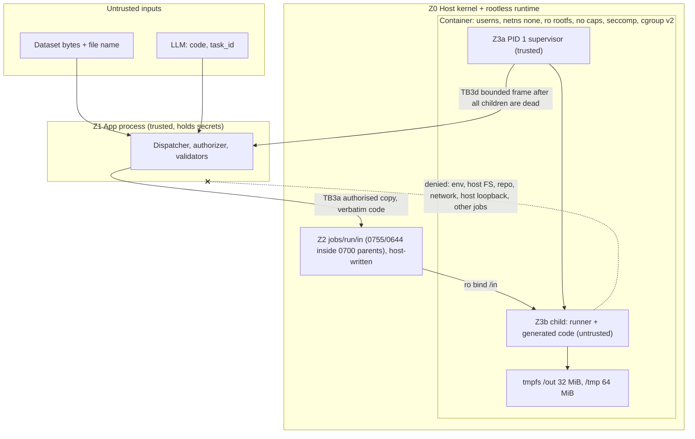
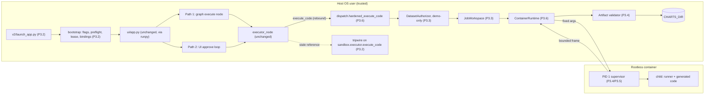
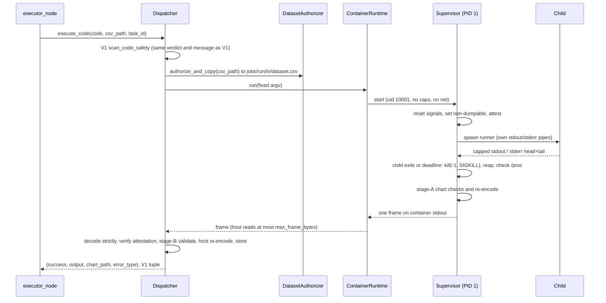

# InsightPilot V2 — P3 Secure Code Execution: Design (rev. 2.1)

**Document status:** consolidated, self-contained design. It merges the P3.0 proposal (rev. 1), the revised architecture (rev. 2) and the 11 corrections of rev. 2.1. It does not depend on any other document or conversation, apart from the P0 and P1 documents it cites (`docs/v2/BASELINE.md`, `docs/v2/FEATURE_FLAGS.md`, `docs/security/*`).

**Review status:** the reviewer has conditionally accepted the architecture. **Only P3.1 is authorised and implemented.** Everything else is a plan and needs separate approval for each stage.

**Status labels used throughout:**

| Label | Meaning |
|---|---|
| **IMPLEMENTED (P3.1)** | Exists on `feature/v2-p3-secure-execution` and is covered by passing tests |
| **PLANNED (P3.n)** | Designed; not implemented; needs stage approval |
| **REQUIRES RUNTIME VALIDATION** | An assumption about Podman, Docker, the kernel or cgroups that must be proven on a real rootless Linux runtime (§14) before it is relied on |
| **UNRESOLVED** | An open engineering question; this document states a position and the reviewer decides (§20) |

---

## 1. Scope and security claims

P3 addresses **one** trust boundary: **TB3, between the app and the generated code** (`docs/security/threat_model.md` §2). It does not make InsightPilot secure as a whole.

- **TB1, TB2, TB4 and TB5 are unchanged until P2 and P5:** uploads, prompts, HTML rendering, the lesson store and exports.
- **Approval is enforced only by the UI until P8** (R-08, R-09).
- **The secure deployment profile stays refused until P2 guardrails exist and are validated** (§7.5). No P3 document, test or handoff may describe the application as secure.

### Claims ledger

| Control | Role | It does **not** prove |
|---|---|---|
| Rootless container: user/mount/PID/IPC/UTS/cgroup namespaces, no network, read-only root, no capabilities, seccomp, cgroup v2 limits | **The security boundary for TB3** (PLANNED) | The kernel is shared, so a kernel exploit escapes. gVisor is a possible later layer. |
| V1 AST scanner (`agent/rules_engine.py:scan_code_safety`, unchanged) | Defence in depth; keeps V1 retry semantics | Bypassable (R-03). Never cited as containment. |
| Minimal environment, timeouts | Defence in depth, availability | Not confinement |
| Feature-flag rules (`config/feature_flags.py`) | Configuration correctness (IMPLEMENTED) | Isolation. The flags only decide which executor is allowed. |

**Testing rule:** isolation tests assert the **effect** (secret not read, file untouched, no connection received, limit enforced). They run with the AST scanner bypassed, so the container alone must contain the bypass corpus.

---

## 2. Verified facts the design is based on

### 2.1 Repository state

Verified for P3.0 and again at the start of P3.1 (2026-11-21).

| Ref | SHA |
|---|---|
| `main` (also the remote default `HEAD`) | `fd5783c6202e3ea506a69e607160617a23eed807`, unchanged |
| `exam-backup-2026-11-17` | `fd5783c6202e3ea506a69e607160617a23eed807`, unchanged |
| `feature/insightpilot-v2` (P3 base) | `1fd3af3c05ba9118b0f03c107f30c0f68659ad51`: merge of P1 (PR #2), which follows the merge of P0 (PR #1) |
| `feature/v2-p3-secure-execution` | Created from `1fd3af3c`; P3.1 commits only |

`git diff fd5783c6..1fd3af3c -- agent sandbox utils ui rules skills data requirements.txt README.md` is **empty**: the base contains no application code changes since the examination snapshot.

### 2.2 Code facts

1. **Both execution paths share one binding point.**
   - **Path 1:** the LangGraph `execute` node (`agent/graph.py:75`), reached through `analyst_graph.stream` (`ui/app.py:948`).
   - **Path 2:** the UI post-approval loop calls `executor_node` directly (`ui/app.py:1045-1074`).
   - Both call `execute_code`, which is resolved from the module globals of `agent.nodes.executor` at call time (imported at line 11, called at line 36).
   - Follow-up chat and replanning execute no code. The exported notebook (R-15) runs outside the app.
2. **The 13 V1 strict-xfail tests call `sandbox.executor.execute_code` directly.** A V2 binding of `agent.nodes.executor.execute_code` therefore leaves them characterising V1.
3. **`tests/v2/conftest.py:isolated_outputs` monkeypatches `sandbox.executor.CHARTS_DIR`.** Hardened code must read it at call time.
4. **The report embeds charts by basename from `reports/charts/`** (`agent/nodes/report_generator.py:78-80, 198-203`).
5. **Reserved prefixes are strict.** An unregistered `IP_FF_*`, `IP_SANDBOX_*` or `IP_HITL_*` variable makes `load_flags()` raise. P3 adds no new variable.
6. **`rules/*.md` files are injected into LLM prompts**, so P3 documents rule alignment (R-24) in `docs/`, never in `rules/`.
7. **V1 returns stale charts.** When the current run made none, V1 still returns an existing `{task_id}.png` (`sandbox/executor.py:134-136`). The hardened path will not do this.
8. **Container CLIs leak host settings by default.** Podman's `--http-proxy` defaults to true. Docker copies `~/.docker/config.json` `proxies` into containers. `containers.conf` can add environment variables and mounts. The effective configuration must therefore be **verified from inside** the container (§8.6 attestation).
9. **`ui/app.py` does not rely on Streamlit "magic".** An AST scan found 8 non-call expression statements, all docstrings (lines 1, 66, 620, 637, 648, 656, 684, 725); all other bare statements are calls (109).
10. **Uploads.** `ui/app.py:801-807` writes uploads to `/tmp/{uploaded.name}`. Demo datasets are `ROOT/data/{sales_data,attendance_data,student_data,ecommerce_timeseries}.csv` (`ui/app.py:737-742, 809`). Their full SHA-256 hashes are pinned in `tests/v2/golden/expected/*.json`.
11. **Missing key.** `utils/llm.py:13` calls `load_dotenv()`. `utils/llm.py:96-100` raises `ValueError("GOOGLE_API_KEY not set…")` when the key is absent.

### 2.3 Container runtime in the design and P3.1 session (cloud container)

- The Docker 29.10.0 client, `dockerd`, `containerd` and `runc` 1.5.3 binaries are present, but **no daemon is running and there is no socket**. None was started.
- Podman, crun, gVisor, bubblewrap and nsjail are absent.
- The session runs as uid 0 inside a Firecracker microVM with a **cgroup v1/hybrid** hierarchy. The kernel supports seccomp.

**Conclusion:** this environment **cannot** validate rootless isolation or cgroup v2 limits. No container claim may rest on it.

### 2.4 Baseline (P3.1)

Re-established in an isolated scratch virtualenv **outside the repository**. Nothing was installed on the examination laptop, and no system or repository packages changed.

| Item | Value |
|---|---|
| Interpreter | CPython 3.11.18 (`/usr/bin/python3.11`), virtualenv created with `uv` |
| Packages | The 100 pins of environment B, derived from the `*.dist-info` names in the committed `venv/` (excluding pip, setuptools and wheel), installed exactly. One extra package was installed: **`watchdog 6.0.0`**, which Streamlit requires on Linux but not on macOS (so the committed macOS `venv/` lacks it). |
| Command | `env -u GOOGLE_API_KEY PYTHONDONTWRITEBYTECODE=1 <venv>/bin/python -m pytest tests -q -p no:cacheprovider -rxXfE` |
| Base `1fd3af3c` | **270 passed, 13 xfailed, 0 failed, 0 xpassed, 0 skipped**, 1 known `UserWarning` (the Streamlit 1.59.2 AppTest workaround, `docs/v2/BASELINE.md`) |
| macOS (environment C) | Still **not verified**. Use the checklist in `docs/v2/BASELINE.md` on the separate V2 checkout only. |

---

## 3. Trust model and boundaries

| Zone | Contents | Trust |
|---|---|---|
| Z0 Host TCB | Host kernel, rootless runtime, pinned image | Trusted; kernel escape is a residual risk |
| Z1 App process | Streamlit, LangGraph, V2 dispatcher and validators, `GOOGLE_API_KEY` | Trusted; holds secrets and must be unreachable from Z3 |
| Z2 Job inputs | Per-run host directory containing `in/code.py` and `in/dataset.csv` (host-written copies) | Written by Z1 only; read-only to Z3 |
| Z3a Supervisor | PID 1 in the container, code from the image | Trusted code in an untrusted environment |
| Z3b Child | `runner.py` plus the generated code | **Untrusted** |
| External | Dataset bytes and name, LLM output (code, task ids) | Untrusted |

**Statements:**

- Access to a rootful Docker socket is equivalent to host root. Rootful runtimes and `euid 0` are therefore rejected.
- **No file written inside the container is ever opened on the host filesystem.** Results leave only as a bounded byte frame (§8.5).
- The frame itself is **untrusted**, because a compromised container could forge it. The host revalidates everything.



| Boundary | Enforcement |
|---|---|
| TB3a host → inputs | Demo-only dataset authorisation (§9); argv grammar allowlist; no untrusted bytes in argv, mount specs or wrapper source |
| TB3b container | Namespaces, `--network=none`, read-only root, `--cap-drop=ALL`, `no-new-privileges`, seccomp, cgroup v2, tmpfs-only writes |
| TB3c supervisor ↔ child | PID-namespace-init signal semantics; `PR_SET_DUMPABLE=0`; extraction only after `kill(-1, SIGKILL)` and full reaping (§8.4) |
| TB3d result → host | Strict frame decoder with per-section caps; attestation check; host revalidation and re-encoding of charts |
| TB-L launcher → V1 | Identity-verified bindings plus a V1-executor tripwire (§7) |

---

## 4. Architecture overview (PLANNED except where marked)





---

## 5. Feature-flag semantics — IMPLEMENTED (P3.1)

### 5.1 Before and after

| `IP_FF_SANDBOX_HARDENED` | `IP_SANDBOX_BACKEND` | Profile | Before P3.1 | After P3.1 |
|---|---|---|---|---|
| 0 (default) | `subprocess` (default) | exam | V1 (`resolve` → `"legacy"`) | **Unchanged:** V1 (`"legacy"`) |
| 0 | `container` | any | `FeatureFlagError` | Unchanged |
| **1** | **`subprocess` or unset** | **exam** | **Accepted.** `resolve` returned `"subprocess"` if the availability callback said so, which implied a hardened subprocess mode existed. | **`InsecureConfigurationError`:** "there is no hardened subprocess mode" |
| 1 | `subprocess` | secure | `InsecureConfigurationError` (secure-profile block) | `InsecureConfigurationError` (new rule, checked earlier) |
| 1 | `container` | exam | Valid; `resolve` → `"container"` if available, else `InsecureConfigurationError` | Unchanged |
| 1 | `container` | secure (+ guardrails `enforce`) | Valid | Unchanged at the flag level. The planned launcher refuses the secure profile until P2 exists (§7.5). |

### 5.2 Change made

`config/feature_flags.py`:

- **`validate()`:** new rule placed after the container-requires-hardened rule and before the secure-profile block:
  ```python
  if flags.sandbox_hardened and flags.sandbox_backend != "container":
      raise InsecureConfigurationError(
          "IP_FF_SANDBOX_HARDENED=1 requires IP_SANDBOX_BACKEND=container: "
          "there is no hardened subprocess mode; the V1 subprocess runs only "
          "when hardening is off")
  ```
- **Docstrings and comments:** the module docstring, the `sandbox_backend` comment and the `resolve_sandbox_backend` docstring now say that hardened execution is container-only.

`docs/v2/FEATURE_FLAGS.md`:

- the "No unsafe fallback" rule now states the container requirement;
- a new "Launch command" rule says `streamlit run ui/app.py` is pure V1, and that the launcher is planned, not implemented;
- the two flag-table rows are updated;
- "In P0 nothing reads these flags" now reads "As of P3.1".

No new variable or value was added, and no other logic changed.

### 5.3 The 28 P0 feature-flag tests (`tests/v2/test_feature_flags.py`, unmodified)

| # | Test (cases) | Path through the new `validate()` | Result |
|---|---|---|---|
| 1 | `test_defaults_are_v1` (1) | hardened False; rule not reached | pass |
| 2 | `test_blank_values_mean_default` (1) | defaults | pass |
| 3 | `test_unrelated_environment_is_ignored` (1) | defaults | pass |
| 4 | `test_bool_parsing` (5) | `IP_FF_TRACING` only | pass |
| 5 | `test_invalid_values_raise_instead_of_defaulting` (6) | raises in `_parse` before `validate` | pass |
| 6 | `test_unknown_reserved_flag_is_rejected` (1) | raises before `validate` | pass |
| 7 | `test_container_requires_hardened` (1) | the existing first rule raises `FeatureFlagError` | pass |
| 8 | `test_dependent_flags_require_parent` (1) | HITL and parallel rules | pass |
| 9 | `test_secure_profile_accepts_isolated_configuration` (1) | hardened + container passes | pass |
| 10 | `test_secure_profile_rejects_weakened_configuration` (4) | case `[backend subprocess]` is now rejected by the new rule; still `InsecureConfigurationError`, and the test does not match messages. The other 3 cases are rejected by the secure block. | pass |
| 11 | `test_legacy_executor_only_when_hardening_not_requested` (1) | `"legacy"` | pass |
| 12 | `test_no_silent_fallback_when_hardened_backend_unavailable` (1) | Assertion 1 (`hardened=True, backend="subprocess"`) now raises in `validate()` inside `resolve` (still `InsecureConfigurationError`). Assertions 2 and 3 unchanged. | pass |
| 13 | `test_validate_rejects_directly_constructed_insecure_flags` (1) | secure block | pass |
| 14 | `test_every_flag_documented` (1) | no new variable | pass |
| 15 | `test_no_v1_module_imports_feature_flags` (1) | no V1 file changed; `v2/` is outside the scanned folders | pass |
| 16 | `test_importing_app_modules_does_not_load_flags` (1) | V1 modules never import `v2` or flags | pass |

**Mutation check (P3.1):** in a throw-away copy of the tree with the new rule removed, **8 of the new P3.1 flag tests fail and the 28 P0 tests still pass**. The P0 tests do not depend on this rule; the new tests guard it.

---

## 6. Execution contracts — IMPLEMENTED (P3.1)

Package `v2/` lives outside the folders the P0 tests scan. Types and interfaces only.

| Module | Contents |
|---|---|
| `v2/__init__.py` | Package docstring (V1 never imports V2) |
| `v2/execution/__init__.py` | Re-exports |
| `v2/execution/isolation.py` | `IsolationLevel` = {`V1_UNISOLATED`, `ROOTLESS_CONTAINER`}. **No process tier.** `.os_isolated` is true only for the container. `isolation_for_backend()` maps `resolve_sandbox_backend()` output (`"legacy"`, `"container"`) and rejects anything else, including `"subprocess"`. |
| `v2/execution/limits.py` | Frozen `Limits` with the **provisional** values of §8.3; validation of positive values and consistency (chart pixels ≤ side², chart ≤ `/out`, tmpfs sizes < memory); derived `stderr_bytes`, `max_frame_bytes`, `host_deadline_seconds`; `DEFAULT_LIMITS` |
| `v2/execution/errors.py` | **Policy:** `SandboxPolicyError(RuntimeError)` → `DatasetNotAuthorizedError`, `ArtifactRejectedError(reason)` with a fixed `ARTIFACT_REJECT_REASONS` set (never attacker text). **Infrastructure:** `SandboxUnavailableError(InsecureConfigurationError)` → `SandboxProtocolError` (correction B-3) |
| `v2/execution/results.py` | `ExecutionOutcome` = {`SUCCEEDED`, `CODE_ERROR`, `TIMED_OUT`, `MEMORY_LIMIT`, `BLOCKED_BY_SCANNER`}; frozen `ExecutionResult` with invariants: run id is 32 lowercase hex; a chart only on success; chart path and reject reason are mutually exclusive; known reasons only; scanner-blocked runs have zero duration; `is_valid_run_id()` |

**Purity, enforced by `tests/v2/p3/test_contract_purity.py`:**

- the contract modules import only `dataclasses`, `enum`, `typing`, `re`, `config.feature_flags` and `v2`;
- they make no `eval`, `exec`, `compile`, `open` or `__import__` calls, and no `system`, `popen`, `spawn`, `fork`, `exec*` or `run_path` attributes;
- importing `v2.execution` in a fresh interpreter loads no subprocess, socket, ssl, http, urllib, multiprocessing, ctypes, runpy, threading, Streamlit, LangChain/LangGraph, Google, dotenv, pandas or V1 application module;
- no V1 module imports `v2`;
- every `.py` file under `v2/` is one of the six reviewed contract modules. This scope guard must be updated deliberately in later stages.

Run ids are only *validated* here. Generating them is planned for the dispatcher, using `secrets.token_hex(16)`. `uuid` was avoided because it imports `platform` on Python 3.11.

---

## 7. Launcher integration — PLANNED (P3.2)

### 7.1 Entrypoint

```python
# v2/launch_app.py
# run: streamlit run v2/launch_app.py --server.fileWatcherType none --server.runOnSave false --server.address 127.0.0.1
import os, runpy, sys
ROOT = os.path.dirname(os.path.dirname(os.path.abspath(__file__)))
if ROOT not in sys.path:
    sys.path.insert(0, ROOT)
from v2.execution import bootstrap
bootstrap.ensure_ready()          # idempotent; flags off: returns having done nothing
runpy.run_path(os.path.join(ROOT, "ui", "app.py"), run_name="__main__")
```

**How it runs `ui/app.py`:**

- Streamlit executes the launcher as its main script on every run and rerun.
- `runpy.run_path` compiles and executes the unmodified `ui/app.py` in a fresh namespace with `__file__` set to `ui/app.py`, so the app's `sys.path.insert` and its `data_dir` resolve exactly as under a direct launch.
- `st.stop()` (`StopException`) and `st.rerun()` (`RerunException`) are ordinary exceptions and propagate through `run_path` to Streamlit's runner.
- On the success path the launcher renders nothing, so `st.set_page_config` stays the first Streamlit command. On failure it renders `st.error` and calls `st.stop()`, so the app never runs.
- Streamlit magic applies only to the main script, and `ui/app.py` has no magic-dependent statements (§2.2 item 9). Tests L-01 and L-03 enforce this.

### 7.2 Bindings (process-global by design)

| Binding | Purpose |
|---|---|
| `agent.nodes.executor.execute_code ← dispatch.hardened_execute_code` | One rebinding covers Path 1 and Path 2 (§2.2 item 1) |
| `sandbox.executor.execute_code ← tripwire` | Any reach to the V1 executor in hardened mode (module reload, future call site, stale reference) raises `InsecureConfigurationError` |
| (`streamlit.file_uploader` observer) | **Not planned.** Needs separate approval (§9.3) |

**Rules:**

- **Bootstrap state machine.** States are `UNINIT → OFF | READY | FAILED`, under a `threading.Lock`.
  - Flags are read **once per process**.
  - `FAILED` is sticky: every rerun shows the error, and a restart is needed.
  - Tests reset state only through a fixture calling `bootstrap._reset_for_tests()` (correction B-8). A test asserts nothing outside `tests/` calls it.
- **Reruns.** Bindings persist in `sys.modules`. `binding.verify()` checks identity before each `run_path`. On a mismatch it rebinds, logs a WARNING and increments a counter.
- **Stale imports and reloads.** Hardened mode requires `server.fileWatcherType=none` and `server.runOnSave=false`; bootstrap refuses otherwise.
  - A reloaded `agent.nodes.executor` re-imports `execute_code` from `sandbox.executor`, which is the tripwire, so it fails closed.
  - A reloaded `sandbox.executor` is caught by `verify()` on the next rerun, before app code runs.
  - An AST census test asserts that only `executor_node` calls `execute_code`.
- **Sessions.** One server process means one binding, so all sessions are hardened (all or nothing per process).
- **Concurrency.**
  - The dispatcher is re-entrant; each call has its own run id, workspace and container.
  - A process-wide `BoundedSemaphore(2)` limits live containers, with a 120 s wait, after which it raises `SandboxUnavailableError("busy")`.
  - The dispatcher never relies on Streamlit's `ScriptRunContext`, because LangGraph may run nodes on worker threads.
- **Cleanup.** `atexit` releases the instance lease. In-flight containers end at their own deadline (§11). Bindings are never uninstalled in production; `binding.uninstall()` exists for tests only.

### 7.3 Failure mapping (V1 tuple preserved)

| Condition | Returned or raised |
|---|---|
| V1 scanner violation | `(False, <identical V1 message>, None, RUNTIME)`, so retries are identical |
| Child non-zero exit | `(False, stderr head+tail, None, classify_error(stderr))`, using V1's classifier |
| Code timeout | `(False, "Execution timed out after 30s.", None, RUNTIME)`, identical to V1 |
| OOM | `(False, "Execution exceeded the memory limit (1024 MiB).", None, RUNTIME)` |
| Success | `(True, stdout or "Execution completed successfully.", chart_path or None, None)` |
| Chart rejected | Success with `chart_path=None` and a WARNING log; output text not altered (D18) |
| Dataset not authorised | **raise** `DatasetNotAuthorizedError`: run stops, no LLM retries |
| Runtime unavailable, attestation mismatch, protocol error, busy | **raise** `SandboxUnavailableError` or `SandboxProtocolError`: no fallback |

### 7.4 Direct `ui/app.py` launch

**`streamlit run ui/app.py` bypasses all V2 hardening, now and after P3.** V1 cannot detect this without code changes, and V1 code will not be changed. See §20 Q1 for the secure deployment boundary.

### 7.5 Secure-profile gate

The launcher holds `P2_GUARDRAILS_IMPLEMENTED = False` and refuses `IP_DEPLOYMENT_PROFILE=secure` with `InsecureConfigurationError` until P2 lands and is validated. P3 testing uses the **P3 isolation configuration**: `exam` profile + `IP_FF_SANDBOX_HARDENED=1` + `IP_SANDBOX_BACKEND=container`.

---

## 8. Container specification — PLANNED (P3.5–P3.7), REQUIRES RUNTIME VALIDATION

### 8.1 Run command (Podman reference; the Docker-rootless adapter is equivalent)

```
podman run --rm --name ip-<inst8>-<run12>
  --label org.insightpilot.instance=<instance_id> --label org.insightpilot.run=<run_id>
  --label org.insightpilot.schema=1
  --pull=never --image-volume=ignore --read-only --read-only-tmpfs=false
  --network=none --dns=none --no-hosts --http-proxy=false
  --ipc=none --cgroupns=private --log-driver=passthrough --timeout=<wall+grace>
  --user 10001:10001 --cap-drop=ALL --security-opt=no-new-privileges
  --memory=1g --memory-swap=1g --cpus=1 --pids-limit=64
  --ulimit nofile=256:256 --ulimit core=0
  --tmpfs /tmp:rw,size=64m,nr_inodes=4096,mode=1777,noexec,nosuid,nodev
  --tmpfs /out:rw,size=32m,nr_inodes=64,mode=1777,noexec,nosuid,nodev
  --mount type=bind,source=<instance>/jobs/<run>/in,target=/in,readonly[,relabel=private on SELinux]
  --env MPLBACKEND=Agg --env HOME=/tmp --env MPLCONFIGDIR=/opt/ip/mpl
  --env OPENBLAS_NUM_THREADS=1 --env OMP_NUM_THREADS=1 --env LANG=C.UTF-8 --env TZ=UTC
  localhost/insightpilot-sandbox@<image-id>
  python -I -B /opt/ip/supervisor.py --wall 30 --stdout-cap 1048576 ...   # integers only
```

- **Argv safety.** The argv is a list (never a shell). Every element must match an allowlist grammar. The instance base path must match `^[A-Za-z0-9/._-]+$`, otherwise fail closed (prevents `--mount` option injection).
- **CLI environment.** The CLI subprocess gets `PATH`, `HOME`, `XDG_RUNTIME_DIR` and `LANG` only.
- **Rejected at preflight:** rootful runtimes, `euid 0`, cgroup v1, and missing `cpu`/`memory`/`pids` controllers.
- **Docker differences:** `--log-driver=none` while attached; no `--timeout` (the supervisor deadline plus a host kill instead); `--read-only` adds no implicit tmpfs.
- **Must be validated on the runtime** (correction B-9 extended this list):
  - `--log-driver=passthrough` with pipe stdio;
  - `nr_inodes` passed through for Podman and Docker `--tmpfs`;
  - `--ipc=none` leaves no `/dev/shm`;
  - `--dns=none` together with `--network=none`;
  - Docker attach behaviour with `--log-driver=none`.

### 8.2 Mount ownership

Under rootless Podman's default mapping, host user U becomes container uid 0, and container uid 10001 becomes subuid S+10000.

| Option | Mechanism | Verdict |
|---|---|---|
| **R1 (chosen)** | The host writes `in/` (0755), `code.py` and `dataset.csv` (0644) inside `jobs/<run>/` (0700) inside `instances/<id>/` (0700). The OCI runtime resolves the bind source as mapped root (U) and can traverse the 0700 parents. The child reaches `/in` only through the mount point and reads as "other". The `readonly` mount gives EROFS; root-owned 0644 files would also refuse writes from 10001. Outputs never touch the host (tmpfs). | No widening of host access: other host accounts are stopped by the 0700 parents |
| R2: chown to the subuid | Host user loses direct access; cleanup needs `podman unshare` | Rejected |
| R3: idmapped mount | Needs kernel ≥ 5.12 and filesystem support; rootless support varies | Deferred |
| R4: `--userns=keep-id` | The child runs as the host uid at kernel level | Rejected (weaker) |
| R5: host-visible writable `/out` | Disk exhaustion, link attacks | Rejected |

**Tests:** O-01 (host modes and owners, ancestors unchanged), O-02 (in-container access matrix), O-03 (a second host account cannot read job files or `/proc/<pid>/root`), O-04 (no non-euid-owned file remains on the host). See §16.

### 8.3 Storage and resource limits

All values are provisional and are the same as `v2.execution.limits.DEFAULT_LIMITS`.

| Location or resource | Enforcement during execution | Host storage touched? |
|---|---|---|
| Root filesystem | `--read-only`, `--read-only-tmpfs=false` (no implicit `/run`, `/var/tmp` or `/tmp`) | no |
| `/out` | tmpfs 32 MiB, 64 inodes | no (RAM) |
| `/tmp` | tmpfs 64 MiB, 4096 inodes | no (RAM) |
| `/dev/shm`, mqueue | `--ipc=none` | no |
| `/dev` | runtime tmpfs, not writable by 10001 (attested) | no |
| Logs | `passthrough` / `none` | no |
| Memory | `memory.max` 1 GiB, swap 0. tmpfs pages are charged to this cgroup, so RSS + tmpfs ≤ 1 GiB (**proven by S-04**) | — |
| CPU, PIDs, files | 1 CPU; 64 PIDs (BLAS threads pinned to 1); `nofile` 256; `core` 0 | — |
| Host-written inputs | Trusted host only: code ≤ 1 MiB, dataset ≤ 256 MiB, at most 2 concurrent jobs | bounded |
| Time | Code 30 s (= V1 `MAX_EXECUTION_TIME`) + 15 s host grace | — |

### 8.4 PID 1 and the extraction protocol

See also §20 Q4.

1. **Supervisor start (before the child):**
   - resets **every catchable signal to `SIG_DFL`**, except `SIGCHLD` (handled, to reap) and `SIGPIPE` (ignored). This is correction B-2: CPython otherwise installs a SIGINT handler, which would let the child deliver SIGINT to PID 1;
   - sets `PR_SET_DUMPABLE=0`;
   - records the attestation (§8.6).
2. **Child:** `python -I -B /opt/ip/runner.py` with stdin `/dev/null`, its own stdout and stderr pipes, `close_fds`, and a new session. The runner provides V1's prelude names (`pd`, `np`, `matplotlib`, `plt`, `mticker`, `sns`, `warnings`, `df` from `/in/dataset.csv`, `CHART_PATH="/out/chart.png"`, the same style and rcParams), then runs `exec(compile(src, "<generated>", "exec"))`, then autosaves open figures.
3. **While the child runs**, the supervisor drains both pipes: stdout head up to 1 MiB, stderr head 128 KiB plus tail 128 KiB. The rest is discarded, and truncation flags are kept.
4. **When the child exits or the deadline passes:** `kill(-1, SIGKILL)`, then reap until `ECHILD`, then confirm that `/proc` lists only PID 1. Daemons the child forked or spawned with `setsid` are gone.
5. Stage-A chart handling (§10), and `oom_kill` read from `/sys/fs/cgroup/memory.events`.
6. **One frame** is written to the container's stdout, then exit 0.

**Signal facts the design relies on (REQUIRES RUNTIME VALIDATION):**

- Signals sent to a PID-namespace init from inside the namespace are delivered only if init has a handler; SIGKILL and SIGSTOP from inside are never delivered.
- From an ancestor namespace, only SIGKILL and SIGSTOP are forced. **The host must therefore stop containers with SIGKILL** (`podman kill -s KILL` / `rm -f -t 0`); SIGTERM is ignored by design.

### 8.5 Result frame and byte budgets

See also §20 Q3.

- **Two streams, never mixed:**
  - The child's stdout and stderr go **only** to the supervisor's pipes. They are user-visible text with their own caps (`stdout_bytes`, `stderr_head_bytes + stderr_tail_bytes`).
  - The container's stdout carries **only** the frame, written once by PID 1 after all child processes are dead. The runtime CLI's own stderr is diagnostics, capped at 64 KiB, logged but never shown to users.
- **Frame layout:** `magic "IPX1"` | `u32 header_len` (≤ `frame_header_bytes`) | UTF-8 JSON header | sections in fixed order: stdout, stderr, chart.
- **Header fields:** schema version, attestation, child exit code and signal, timed-out flag, OOM count, each section's declared length and SHA-256, truncation flags, chart reject reason, count of other `/out` entries.
- **Bounds:**
  - each declared length must be ≤ its own cap, even when the total would fit;
  - `max_frame_bytes = frame_header_bytes + stdout_bytes + stderr_bytes + chart_bytes`, derived in `Limits` (IMPLEMENTED);
  - the host reads at most `max_frame_bytes + 1` bytes; one byte more kills the container and raises `SandboxProtocolError`;
  - SHA-256 is checked for each section; no trailing bytes are allowed.
- **Memory:** the supervisor never holds more than the caps, because it caps while collecting, not when framing.

### 8.6 Per-run attestation

Recorded by the supervisor **before** the child starts:

- uid/gid;
- `CapEff`, `CapPrm` and `CapBnd` all 0, `NoNewPrivs` = 1, `Seccomp` = 2;
- network interfaces = {`lo`};
- writable mounts = {`/out`, `/tmp`};
- `/dev` not writable;
- enforced limits read from cgroupfs (`memory.max`, `memory.swap.max`, `pids.max`, `cpu.max`).

The host compares this with the expected values. Any mismatch raises `SandboxUnavailableError`. This catches drift in `containers.conf` or the runtime on **every** run.

### 8.7 Runtime image (PLANNED P3.5)

- **Base:** `python:3.11-slim-bookworm@sha256:<digest>`.
- **Packages:** only the rules allowlist (pandas, numpy, matplotlib, seaborn, scipy, scikit-learn) at environment-B versions, installed from `requirements.lock` with `pip --require-hashes`.
- **Final stage:**
  - no pip, setuptools, compilers, setuid bits or `VOLUME` directives;
  - user 10001;
  - a pre-built read-only matplotlib font cache;
  - supervisor, runner and canonicaliser at `/opt/ip/`.
- **Build context:** staged by `scripts/p3_build_image.sh` from an explicit file list (`v2/execution/sandbox_side/`, `v2/execution/image/`). It is never the repository root, so `.env` can never reach the image.
- **Provenance:** the image carries a label with the lock hash; the backend refuses a mismatch; the image id is recorded in every run.
- **Claims:** inputs are pinned and a rebuild yields an identical package set. A bit-identical image digest is **not** claimed.

---

## 9. Dataset authorization — PLANNED (P3.3), demo-only first

### 9.1 Principle

The only bytes that may enter a container are **byte-identical pinned demo datasets**. Uploads are refused in hardened mode until an upload registry is separately approved (§9.3). V1 upload behaviour is unchanged.

### 9.2 Demo policy

1. `realpath(dirname(csv_path))` must equal `realpath(ROOT/data)`, which is computed once from trusted code (correction B-5). The basename must be exactly one of the four demo names.
2. `dir_fd = open(realpath(ROOT/data), O_DIRECTORY|O_NOFOLLOW)`; `fd = openat(dir_fd, name, O_RDONLY|O_NOFOLLOW|O_NONBLOCK|O_CLOEXEC)`. A symlinked final component gives ELOOP; a FIFO does not block.
3. `fstat(fd)`: `S_ISREG`, `st_nlink == 1`, `st_uid == geteuid()`, size ≤ `dataset_bytes`.
4. Stream into `in/dataset.csv` (opened with `O_CREAT|O_EXCL|O_NOFOLLOW` relative to the job directory fd), stopping at cap + 1 and computing SHA-256 while copying.
5. `fstat` again (dev, ino, size, `mtime_ns` unchanged), and the digest must equal the pinned SHA-256. The pins in `v2` are cross-checked against `tests/v2/golden/expected/*.json` by a test, so they cannot drift.
6. On any failure: delete the partial copy and raise `DatasetNotAuthorizedError`. The container mounts **only the copy**.

What was hashed is exactly what was copied, through one stable handle, so there is no TOCTOU window. Rejected: traversal, relative paths, NUL and control characters, subdirectories, symlinks, FIFOs, sockets, devices, hardlinks, foreign owners, oversize files, changed content, and the V1 S3 crafted path.

### 9.3 Uploads (deferred; needs separate approval)

The proposed mechanism is an observer wrapper on `streamlit.file_uploader` that records `(name, sha256(getbuffer()), file_id)`, plus the same fd-based checks with the root at `realpath("/tmp")` and a hash match against the registry. It is **not** to be implemented without separate approval, because it monkeypatches a public Streamlit API process-wide. If it is approved later, it must:

- return the identical object;
- never raise its own errors;
- handle `None`, a single file and lists (correction B-7);
- be LRU-bounded.

### 9.4 Remaining for P2

- V1's own upload write: it follows symlinks and accepts traversal names (R-07).
- Per-session upload directories with server-generated names.
- A session-scoped registry.
- Upload size limits at the Streamlit layer.
- CSV content and prompt-injection guardrails.
- Display-name escaping.
- Report and notebook path confinement.
- The shared `/tmp` namespace (R-18).

---

## 10. Artifact validation — PLANNED (P3.4 host side, P3.5 in-container)

**Stage A, in the container, after every untrusted process is dead:**

1. `lstat('/out/chart.png')`: must be a regular file (not a symlink, directory, FIFO, socket or device), with `st_nlink == 1`, `0 < size ≤ chart_bytes`.
2. Open with `O_RDONLY|O_NOFOLLOW|O_NONBLOCK`; the `fstat` must match the `lstat`; read ≤ cap.
3. Pillow with `MAX_IMAGE_PIXELS = chart_max_pixels`, and `DecompressionBombWarning` raised as an error:
   - `format == "PNG"` → `verify()` → reopen → `load()`;
   - sides ≤ `chart_max_side`;
   - convert to RGB or RGBA;
   - **re-encode with no metadata and no `dpi`**.
4. Report a reason code only. Other `/out` entries are reported as a count; names are never forwarded.

**Stage B, on the host, assuming stage A may be compromised:**

1. A standard-library chunk walker:
   - signature checked;
   - every chunk length ≤ remaining bytes;
   - CRC-32 verified on every chunk;
   - **only IHDR (first, once), contiguous IDAT (≥ 1), and IEND (last, empty), with no trailing bytes.**
2. IHDR checks: 1 ≤ w, h ≤ 8192; w·h ≤ 16.8 Mpx; bit depth 8; colour type 2 or 6; compression, filter and interlace all 0.
3. Bounded inflate:
   - expected = h·(1 + w·channels);
   - `decompressobj().decompress(chunk, max_length)` in increments;
   - the output must be exactly the expected length, `eof=True` and `unused_data == b""`;
   - every row filter byte must be in {0…4}.
4. Host Pillow decode under the same limits; size and mode must match IHDR. Then **host re-encode**, so the stored bytes come from the host encoder.
5. **Store:**
   - stem = `task_id` if it matches `^[A-Za-z0-9_-]{1,40}$`, else `task-<sha256(task_id)[:12]>`;
   - name `<stem>-<run8>.png` (unique; D8);
   - write a temporary file with `O_CREAT|O_EXCL|O_NOFOLLOW` relative to the `CHARTS_DIR` directory fd (read at call time), `fsync`, `os.replace`;
   - the final path must be a direct child of `realpath(CHARTS_DIR)`.
6. `CHART_SAVED:` lines are removed from the displayed stdout and never used as a path (R-20). There is no stale-chart fallback.

**Correction B-6.** Matplotlib's raw output contains `tEXt` and `pHYs` chunks, which stage B rejects. That is intended: stage B only ever sees stage-A output. Test A-01 uses a real Matplotlib chart passed through stage A; test A-21 checks that a raw Matplotlib PNG reaching stage B (simulating a compromised stage A) is rejected.

**Text outputs:** decode UTF-8 with `errors="replace"`; strip NUL and C0 controls except `\n` and `\t`; apply caps; stderr keeps head and tail so `classify_error` still sees the exception line.

---

## 11. Concurrency-safe cleanup — PLANNED (P3.3 lease, P3.6 containers)

- **Instance lease:** `instances/<instance_id>/` (0700) contains `lease.json` (pid, process start time, `boot_id`; diagnostics only) and `lease.lock`, which is held with `flock` for the process lifetime.
- **Per run:**
  - run id = `secrets.token_hex(16)`;
  - container name `ip-<inst8>-<run12>`;
  - labels for instance and run;
  - `finally:` remove by **exact name**, remove the job directory, verify both are gone.
- **Stale detection at startup:**
  - for every *other* instance directory: if its `flock` can be acquired (owner dead; PID reuse cannot fool this) or its `boot_id` differs, remove only containers labelled with **that exact instance id**, then the directory;
  - a held lock means the instance is live and is never touched;
  - a container carrying the schema label but with no lease directory is **reported, never deleted** (`scripts/p3_cleanup.sh --orphans`, manual).
- **Self-termination:** the supervisor deadline, the host deadline and `podman --timeout` together with `--rm` mean a crashed app leaves no long-lived containers.
- No generic project-wide label filter is ever used for deletion.

---

## 12. Validation environment and claim rule — PLANNED

- **Runtimes:** rootless Podman (preferred), rootless Docker (alternative adapter, same tests). Rootful runtimes are refused.
- **VE-1: GitHub Actions `ubuntu-24.04`, usable only if its capability probe passes.**
  - Probe: runner user ≠ root; `podman info` reports rootless, cgroup v2 and controllers ⊇ {cpu, memory, pids}; a 64 MiB container allocating 128 MiB is OOM-killed; a PID-limit probe is enforced.
  - If any check fails, the job **fails** with "environment unsuitable". It never reports tests as passed or skipped.
  - Feature-branch workflow only; `push` and `workflow_dispatch`; no secrets; no `pull_request_target`; read-only token.
- **VE-2: reproducible Ubuntu 24.04 VM** (`validation/vm/user-data.yaml`, planned):
  - pinned cloud image SHA-256;
  - apt packages from a fixed `snapshot.ubuntu.com` timestamp (podman, crun, uidmap, passt);
  - unprivileged `ipval` user with subuid/subgid ranges, linger enabled, and delegation verified (`user@<uid>.service/cgroup.controllers ⊇ {cpu, memory, pids}`);
  - second account `ipprobe`;
  - optional Docker-rootless profile.
  - It runs on a reviewer-controlled Linux host: never the examination laptop, never the cloud design session.
- **`scripts/p3_validate.sh`** (planned) writes JUnit XML plus `evidence.json`: git SHA, kernel, runtime and version, rootless and cgroup facts, image id, lock hash, per-test outcomes with skip counts.
- **Claim rule:** "P3 isolation verified" requires an evidence report in which every `@container` test **executed and passed, with 0 skips** (`IP_TEST_REQUIRE_CONTAINER=1` turns a missing runtime into a failure). **Skipped tests are not proof.**

---

## 13. Performance — PROVISIONAL

- **Added per-run cost:** container create and teardown, supervisor, a frame of up to about 11.3 MiB, two PNG decode/re-encode passes, the dataset copy. **One-time cost:** the preflight self-test.
- **Harness** (`scripts/bench_sandbox.py`, planned, run in the VE):
  - workloads `print(1)`, the golden sales task, and the 15,600-row attendance groupby plus chart;
  - legacy vs container, N = 30 each, interleaved, cold and warm;
  - reported: p50, p95, max, stage split, `memory.peak`, image size, environment fingerprint.
- **Provisional targets, to be confirmed by measurement:** container p95 overhead ≤ 1.5 s per execution; golden end-to-end ≤ 2× V1 wall time.
- **Tokens and cost:** no prompt changes; LLM calls per skill must equal the golden snapshots. Live budget is $0.

---

## 14. Assumptions that require real rootless-runtime validation

| Assumption | Test |
|---|---|
| Rootless default mapping (host U → container 0; 10001 → subuid) and R1 read access through 0700 parents | O-01…O-04 |
| `readonly` bind gives EROFS; nothing outside `/out` and `/tmp` is writable | O-02, S-03 |
| tmpfs `size=` and `nr_inodes=` are enforced (Podman and Docker) | S-01, S-02 |
| tmpfs pages are charged to the container memory cgroup | S-04 |
| `--ipc=none` removes `/dev/shm`; `--read-only-tmpfs=false` adds nothing | S-03 |
| `passthrough` / `none` logging writes no host log files | S-05 |
| `--network=none` + `--dns=none`: only `lo`; host loopback and abstract sockets unreachable | I-06 |
| `--cap-drop=ALL`, `no-new-privileges`, default seccomp active (`Seccomp` = 2) | I-07, I-13 |
| cgroup v2 limits actually applied (`memory.max`, `pids.max`, `cpu.max` read back) | preflight self-test, R-01…R-06 |
| PID-1 signal semantics with a Python supervisor; `PR_SET_DUMPABLE` blocks same-uid ptrace and `/proc/1/*` | I-10, I-14 |
| `kill(-1, SIGKILL)` from PID 1 removes every child, including `setsid` daemons | I-11 |
| `podman --timeout` and `--rm` remove containers after an app crash | C-06 |
| Rootless Docker equivalents for every row above | the same tests with the Docker adapter |

---

## 15. Image, CI and dependency changes

None in P3.1. Every one of these needs its own review gate:

- new pinned dependencies (inside the image only; host `requirements.txt` unchanged);
- the GitHub Actions workflow file;
- the VM definition.

---

## 16. Acceptance-test matrix

Test IDs use these prefixes (correction B-4 renamed the dataset tests to DS-xx):

| Prefix | Area |
|---|---|
| F | flags |
| CT | contracts |
| L | launcher |
| DS | datasets |
| O | ownership |
| S | storage |
| I | isolation |
| R | resources |
| A | artifacts |
| C | cleanup |
| G | regression |
| IMG | image |
| P | performance |

**Environments:**

- **C** = Linux without a container runtime (FakeRuntime where needed; results labelled **wiring-only**).
- **VE** = validation environment (must execute; a skip counts as failure).
- ★ = AST scanner bypassed.

| ID | Test | Env | Status |
|---|---|---|---|
| **F-01** | P0 `test_feature_flags.py` unchanged | C | **IMPLEMENTED: 28/28 pass** |
| F-02 | Hardened with backend `subprocess`, unset or blank → `InsecureConfigurationError` (exam, secure, directly constructed) | C | **IMPLEMENTED** (`tests/v2/p3/test_flags_p3.py`) |
| F-03 | Hardened + container valid; `resolve` returns `"container"` only if available | C | **IMPLEMENTED** |
| F-04 | Hardening off → `"legacy"` without consulting availability | C | **IMPLEMENTED** |
| F-05 | Resolver never returns `"subprocess"` even when "available"; error is still a `FeatureFlagError` | C | **IMPLEMENTED** |
| F-06 | Docs state the container requirement and the `ui/app.py` bypass | C | **IMPLEMENTED** |
| F-07 | Launcher refuses the secure profile (P2 missing) | C | PLANNED (P3.2) |
| **CT-01** | Exactly two isolation levels, no process tier; only the container is OS-isolated; backend mapping rejects `"subprocess"` | C | **IMPLEMENTED** (`test_contracts_p3.py`) |
| CT-02 | `Limits`: frozen, positive, consistent; derived frame budget; default wall clock = V1 `MAX_EXECUTION_TIME` | C | **IMPLEMENTED** |
| CT-03 | Error families separate; fixed artifact reason set | C | **IMPLEMENTED** |
| CT-04 | `ExecutionResult` invariants; run-id format | C | **IMPLEMENTED** |
| CT-05 | Contract purity (AST allowlist, fresh-interpreter import set, P3.1 file scope); no V1 module imports `v2` | C | **IMPLEMENTED** (`test_contract_purity.py`) |
| **L-01** | AppTest `v2/launch_app.py` vs `ui/app.py`, flags off: load, demo, run → approval, approve, 7 pages, chat. Identical elements and `session_state`; normalised run equals the **committed** `sales_ui_approve_safe_mode_on` | C | PLANNED (P3.2) |
| L-02 | Flags off: original identities; no V2 runtime modules loaded | C | PLANNED |
| L-03 | AST invariant: `ui/app.py` has only docstrings and calls as bare statements | C | PLANNED |
| L-04 | Flags on, FakeRuntime: Path 1 and Path 2 each call the backend once per executor log entry; tripwire never fires | C | PLANNED |
| L-05 | 20 reruns: one bootstrap init; identity checked every rerun; no double-wrapping | C | PLANNED |
| L-06 | Reload `agent.nodes.executor`, then `sandbox.executor` → tripwire raises; next rerun rebinds | C | PLANNED |
| L-07 | Call-site census: only `executor_node` calls `execute_code` | C | PLANNED |
| L-08 | Preflight failure: one error element; app never runs | C | PLANNED |
| L-09 | File watcher on in hardened mode → refused | C | PLANNED |
| L-10 | Deployment-unit invariants (§20 Q1) → refused if violated | C | PLANNED |
| L-11 | Two parallel AppTest sessions: no crossed results; ≤ 2 concurrent | C | PLANNED |
| L-12 | Playwright real browser via a test-only mock-LLM launcher: demo → run → approve → chart `` loads → report present | VE (C wiring-only) | PLANNED (P3.8) |
| L-13 | Direct `ui/app.py` with hardened flags inside the deployment unit's constraints: documents the bypass; 0 executions when the key is withheld | C | PLANNED |
| **DS-01/02** | Demo pins; tampered copy refused; pins equal the golden JSON | C | PLANNED (P3.3) |
| DS-03 | Any non-demo path (including any `/tmp` upload) → `DatasetNotAuthorizedError` in demo-only mode | C | PLANNED |
| DS-05 | Traversal, relative, NUL, newline, subdirectory refused before any open | C | PLANNED |
| DS-06/07/08 | Symlink, FIFO (no hang), directory, socket, device, hardlink refused | C | PLANNED |
| DS-09 | Foreign owner refused | C / VE | PLANNED |
| DS-10/11 | Oversize (abort at cap+1); swap or in-place modification during copy → refused and partial copy deleted | C | PLANNED |
| DS-12 | V1 S3 crafted path → refused; marker absent; 0 executions | C | PLANNED |
| DS-13 | Job inputs are only `code.py` and `dataset.csv`; argv contains no `csv_path` or `task_id` bytes | C | PLANNED |
| DS-15 | Demo directory reached through a symlinked `DATA_DIR` accepted; symlinked final component refused (B-5) | C | PLANNED |
| **O-01…04** | Ownership (§8.2) | VE (O-01 also C) | PLANNED |
| **S-01/02** ★ | `/out` and `/tmp` fill: ENOSPC at the byte and inode caps | VE | PLANNED |
| S-03 ★ | Writes to `/`, `/in`, `/var/tmp`, `/run`, `/dev/shm`, `/dev` fail | VE | PLANNED |
| S-04 ★ | Fill tmpfs + allocate 950 MiB → OOM | VE | PLANNED |
| S-05 ★ | Exhaustion run: host free space changes < 1 MiB beyond host-written inputs; no log growth | VE | PLANNED |
| S-06 ★ | 100 MB stdout flood; oversized or forged frame → host bounded, `SandboxProtocolError` | VE / C | PLANNED |
| **I-01** ★ | Dummy `GOOGLE_API_KEY` and proxy variables in parent: absent in the container; environment ⊆ allowlist | VE | PLANNED |
| I-02 ★ | The 5 P0 bypass shapes are contained | VE | PLANNED |
| I-03/04/05 ★ | Host files, repository, host `/proc/*/environ` unreadable; writes outside fail; repository hashes unchanged | VE | PLANNED |
| I-06 ★ | Host loopback listener, abstract socket, DNS, 169.254.169.254 unreachable; interfaces = {`lo`} | VE | PLANNED |
| I-07/08 | uid ≠ 0, `CapEff` 0, `NoNewPrivs` 1, `Seccomp` 2; mountinfo allowlist; no runtime sockets | VE | PLANNED |
| I-09 | Rootful runtime, euid 0, cgroup v1, missing controllers → preflight refuses | C | PLANNED |
| I-10 ★ | Child sends SIGINT, SIGTERM, SIGHUP, SIGUSR1, SIGKILL, SIGSTOP to PID 1; ptrace(1); `/proc/1/mem`; `/proc/1/fd/1` → no effect; frame intact (B-2) | VE | PLANNED |
| I-11 ★ | Background daemon outliving the child is killed before extraction; `/proc` shows only PID 1 | VE | PLANNED |
| I-12 | Attestation mismatch → `SandboxUnavailableError` | C | PLANNED |
| I-13 ★ | keyctl, unshare, mount denied | VE | PLANNED |
| I-14 | Host stop: `kill -s TERM` has no effect; `kill -s KILL` stops; zombie reaping under a 50-grandchild churn leaves `pids.current` back at baseline | VE | PLANNED |
| **R-01…06** ★ | Memory OOM message; PID limit; CPU loop → V1-identical timeout message; SIGTERM-ignoring child; `nofile`; fork bomb | VE | PLANNED |
| **A-01…21** | Artifact corpus: valid chart through stage A; wrong magic; renamed JPEG/SVG; bad CRC; tEXt, iCCP, zTXt, eXIf; APNG; interlaced; 16-bit; palette; dimensions over cap; pixel bomb; zlib bomb; truncated IDAT; trailing data and polyglot; double IHDR; empty; over size; symlink, hardlink, FIFO or directory `chart.png` (VE); atomic unique store and safe stem; raw Matplotlib PNG at stage B rejected (B-6) | C / VE | PLANNED |
| **C-01…08** | Exact-name cleanup; live instance B untouched by A's reconcile; stale instance cleaned up via flock even with PID reuse; orphan reported but not removed; crash → self-termination; changed `boot_id` → stale; 8 dispatches with limit 2 | VE / C | PLANNED |
| **G-01** | Full suite, flags off | C + VE | **IMPLEMENTED for P3.1: see §17** |
| G-02 | Golden snapshots byte-identical (`git diff --exit-code tests/v2/golden`) | C | **IMPLEMENTED (checked for P3.1)** |
| G-03 | Golden end-to-end, 4 datasets, container backend: 28 answers; behaviour equals the committed snapshots; LLM calls equal | VE | PLANNED |
| G-04/05 | Retry semantics identical; UI AppTest through the launcher with the container backend | VE | PLANNED |
| G-06 | 13 strict-xfails remain xfailed in the same session after hardened fixtures ran, **and 0 tripwire hits**: a leaked tripwire would raise `InsecureConfigurationError`, which is not the `AssertionError` the xfails require, so it would show up as a failure (B-11) | C + VE | PLANNED (13 xfails checked for P3.1) |
| G-07 | No diff in V1 paths or P0 test files | C | **IMPLEMENTED (checked for P3.1)** |
| **IMG-01…05** | Hash-locked build; labels; no pip, setuid or `VOLUME`; user 10001; staged build context; reproducible package set | VE | PLANNED |
| **P-01/02** | Benchmark; preflight duration | VE | PLANNED |

**Additional rule (correction B-10):** P3.4 unit tests call pure functions (frame encode and decode, signal setup, attestation parsing) with benign fixtures only. No host-side execution backend may exist; a test asserts that the dispatcher has exactly one backend, `ContainerRuntime`.

---

## 17. Implementation stages

| Stage | Scope | Environment | Status |
|---|---|---|---|
| **P3.1** | Baseline re-run in a scratch venv; B1 flag rule; pure contracts; this document | C | **IMPLEMENTED** |
| P3.2 | Launcher, bootstrap, bindings, tripwire, secure gate, deployment-unit checks. Container always unavailable, so it fails closed. | C | PLANNED |
| P3.3 | Demo-only `DatasetAuthorizer`, instance lease, `JobWorkspace` | C | PLANNED |
| P3.4 | Frame protocol, strict decoder, host PNG validator, re-encode and store; pure supervisor, runner and canonicaliser functions (no backend) | C | PLANNED |
| P3.5 | Runtime image: Containerfile, hash lock, staged build, verification. **Dependency review gate.** | VE | PLANNED |
| P3.6 | Container backend: detection, argv builder, run/kill/remove, preflight self-test, reconcile, dispatcher. **Sandbox-permission review gate.** | C (unit) + VE | PLANNED |
| P3.7 | Resource and storage limit enforcement; optional custom seccomp | VE | PLANNED |
| P3.8 | Integration: golden end-to-end and UI through the launcher; real browser; benchmark; R-24 alignment in docs; handoff. **Senior review before merging into `feature/insightpilot-v2`.** | VE + C | PLANNED |

**P3.1 test results** (scratch venv, §2.4 environment):

| Run | Result |
|---|---|
| Base `1fd3af3c` (before changes) | 270 passed, 13 xfailed, 0 failed |
| After P3.1, the 270 existing tests plus 13 xfails | unchanged: 270 passed, 13 xfailed |
| New `tests/v2/p3` | 166 passed (F-02…F-06, CT-01…CT-05) |
| Full suite after P3.1 | **436 passed, 13 xfailed, 0 failed, 0 skipped** |
| Golden snapshots | byte-identical; never regenerated |

---

## 18. Rollback

- **P3.1:** `git revert <P3.1 commit>` on `feature/v2-p3-secure-execution`. No history rewriting. Reverting restores the earlier acceptance of `hardened=1` with `backend=subprocess`, which was harmless because no component reads the flags.
- **Later stages:** revert the stage commit or merge. Operationally, unset the flags or launch `ui/app.py`.
- **VE artefacts:** `scripts/p3_cleanup.sh --instance <id>`, then remove the image tag.
- **Examination laptop:** nothing is installed there, so there is nothing to roll back.

---

## 19. Remaining risks and non-goals

**Risks:**

1. **Shared kernel.** A kernel exploit escapes the namespaces.
2. **The direct `ui/app.py` launch bypasses V2** (§20 Q1).
3. **The supervisor shares uid 10001 with the child.** Separation relies on PID-namespace-init semantics and non-dumpability, which must be proven (I-10).
4. **The host parses untrusted bytes** (frame, text, PNG): bounded and structurally validated first; a residual Pillow or zlib risk remains.
5. **Uploads are unsupported in hardened mode** until approved. V1 upload writing is unchanged (P2).
6. **`CHARTS_DIR` is shared across sessions** (R-18): unique names prevent overwrites but not visibility (P5).
7. **Runtime configuration drift** is caught by attestation only for the attested properties.
8. **Supply chain:** public base image and wheels, hash-pinned.
9. **Unauthenticated Streamlit server** (R-18).
10. **VE-1 may prove unsuitable.**
11. **Performance unmeasured.**
12. **Streamlit version drift** could affect the `runpy` equivalence (L-01, L-03).

**Non-goals for P3:**

- a secure deployment, which requires P2, P5 and P8;
- prompt-injection, HTML, lesson or export guardrails (P2);
- approval enforcement (P8);
- notebook-export execution (R-15);
- macOS or Windows isolation (hardened mode refuses there; the exam laptop is unchanged);
- multi-tenant hosting and authentication;
- network access or package installs inside the sandbox;
- warm container pools;
- side-channel resistance.

---

## 20. Unresolved engineering questions (positions for review)

### Q1. A direct V1 launch is not safe just because the API key is withheld. What is the secure deployment boundary?

Withholding the key stops V1 from planning and generating code, but a V1 process still:

- serves an unauthenticated UI on the network (R-18);
- writes uploads to `/tmp/{name}` while following symlinks and accepting traversal names: attacker-chosen file writes with **no LLM involved** (R-07);
- parses untrusted CSVs in the host process;
- renders unescaped untrusted HTML (R-13);
- gains code execution again as soon as anyone puts a key into `.env` or the environment.

Key withholding is therefore a **tripwire, not the boundary**.

**Position:** the secure deployment boundary is a **deployment unit**, not a code path:

1. **A dedicated unprivileged service account** (no login shell, no sudo) is the only identity that can read the V2 secrets file (0600) and the instance base, and the only one that runs the app. Operators without that account cannot start an app process holding the key.
2. **One supervised entrypoint** (a systemd unit, or the application's own container in a later phase) executes `scripts/run_insightpilot_v2.sh` → `streamlit run v2/launch_app.py …`. No other unit or command starts InsightPilot in that deployment.
3. **No `.env` in the deployed checkout**; the key is loaded by the launcher only after preflight; the checkout is read-only to the service account.
4. **Network:** `--server.address 127.0.0.1` until an authenticating reverse proxy exists (P5).
5. **The launcher self-checks the invariants it can observe** and refuses to start if any fails: euid not root; flags valid; file watcher off; no `.env`; key not inherited; secrets file owner and mode; rootless runtime.
6. **A trusted administrator** who deliberately runs `ui/app.py` inside the unit is outside the threat model (A-5) and is documented as such.

Until P2, P5 and P8 are implemented and validated, **no deployment is called secure**, and the secure profile is refused.

### Q2. Demo datasets first; no Streamlit uploader monkeypatch without separate approval

Adopted. P3.3 implements the demo-only policy (§9.2). The upload observer (§9.3) is deferred to a separately approved step, or replaced by P2's server-side upload registry.

### Q3. How do bounded binary frames coexist with the stdout/stderr byte limits?

Answered in §8.5:

- separate streams (child pipes → supervisor; supervisor → container stdout);
- per-section caps applied while collecting;
- a derived frame maximum (`Limits.max_frame_bytes`, IMPLEMENTED);
- declared lengths checked against their own caps;
- the host reads at most `max_frame_bytes + 1` bytes;
- runtime CLI stderr capped separately and never shown to users.

### Q4. A custom PID-1 supervisor or a separate init process?

| Option | Signal protection for the supervisor | Privilege needed | Complexity |
|---|---|---|---|
| **(a) Custom supervisor as PID 1, no `--init` (recommended)** | Yes: PID-namespace init ignores same-namespace signals without handlers; non-dumpable blocks ptrace | None beyond uid 10001 | Must reap zombies and reset signal dispositions (B-2) |
| (b) `--init` (catatonit/tini) as PID 1, supervisor as PID 2 | **No:** a same-uid child can SIGKILL PID 2, so extraction integrity needs a different uid for the supervisor | `CAP_SETUID`/`CAP_SETGID` at start | Two processes plus capability handling |

Position: (a). All signal behaviour is **REQUIRES RUNTIME VALIDATION**: tests I-10, I-11 and I-14.

### Q5. Runtime-dependent properties

UID mappings, mounts, tmpfs limits, image settings and the security properties are listed in §14. None is claimed until a VE evidence report shows the tests executed and passed with 0 skips.

### Q6. P3 does not secure the application

P3 isolates TB3 only. TB1, TB2, TB4 and TB5 (P2) and approval enforcement (P8) remain open. Every P3 handoff must say "TB3 isolation (verified or not verified); application not secure".

---

## 21. Decisions

| # | Decision | Status |
|---|---|---|
| D1 | B1: hardened requires container; no process tier | **Approved and IMPLEMENTED (P3.1)** |
| D2 | Launcher: `runpy` + bootstrap + dispatch binding + V1 tripwire; file watcher off | Conditionally accepted; P3.2 needs approval |
| D3 | Deployment unit (§20 Q1) with launcher self-checks; key withheld from direct launches | **UNRESOLVED:** reviewer to confirm the boundary definition |
| D4 | Ownership R1; reject R2, R4 and R5; defer R3 | Conditionally accepted |
| D5 | tmpfs-only storage, `--read-only-tmpfs=false`, `--ipc=none`, no logs, frame-only extraction | Conditionally accepted |
| D6 | Custom PID-1 supervisor, same uid, non-dumpable, signals reset (B-2); custom seccomp optional | Conditionally accepted; requires runtime validation |
| D7 | Datasets: **demo-only first**; uploader observer only after separate approval | **Reviewer direction adopted** |
| D8 | Unique chart names `<stem>-<run8>.png` | Conditionally accepted |
| D9 | Provisional limits (`DEFAULT_LIMITS`) | Contract IMPLEMENTED; values provisional |
| D10 | Two concurrent containers per instance; 120 s queue wait | Conditionally accepted |
| D11 | VE-1 probe first, plus the VE-2 VM definition; who runs VE-2 | **Open** |
| D12 | Image base and contents (§8.7) | P3.5 review gate |
| D13 | Test-only mock-LLM launcher for Playwright | Open (P3.8) |
| D14 | Scratch venv for the baseline in the cloud session only | **Approved and done (P3.1)** |
| D15 | Policy and infrastructure failures raise; no retries, no fallback | Contract IMPLEMENTED (error families) |
| D16 | Stages P3.1–P3.8 with review gates | Conditionally accepted |
| D17 | Top-level package `v2/` | **IMPLEMENTED** |
| D18 | Rejected chart → success with `chart_path=None` and a warning | Contract IMPLEMENTED (`ExecutionResult`) |
| D19 | Policy and infrastructure error hierarchy (B-3) | **IMPLEMENTED** |

---

## 22. Revision history

| Revision | Content |
|---|---|
| rev. 1 | Initial P3.0 proposal: rootless container recommended. It proposed a labelled process tier, later **rejected**. |
| rev. 2 | Reviewer decisions 1–9: B1; launcher reliability; ownership R1; tmpfs storage plus frame extraction; dataset authorisation; two-stage artifact validation; lease-based cleanup; VE claim rule; 8 stages |
| rev. 2.1 | 11 corrections, all integrated into this document: **B-1** exact flag and doc diffs (§5.2); **B-2** reset PID-1 signal dispositions (§8.4, I-10); **B-3** separate error families (§6); **B-4** dataset tests renamed DS-xx (§16); **B-5** demo-path realpath comparison (§9.2, DS-15); **B-6** strict PNG allowlist applies to stage-A output only (§10, A-21); **B-7** uploader observer return shapes (§9.3, deferred); **B-8** test-only bootstrap reset (§7.2); **B-9** more runtime flags to verify (§8.1); **B-10** P3.4 tests use pure functions only; single backend (§16); **B-11** a tripwire leak fails the V1 xfails loudly (G-06) |
| rev. 2.1 + P3.1 | Status markers; P3.1 implementation and results; reviewer directions (demo-only datasets; no uploader monkeypatch) and open questions Q1–Q6 |
