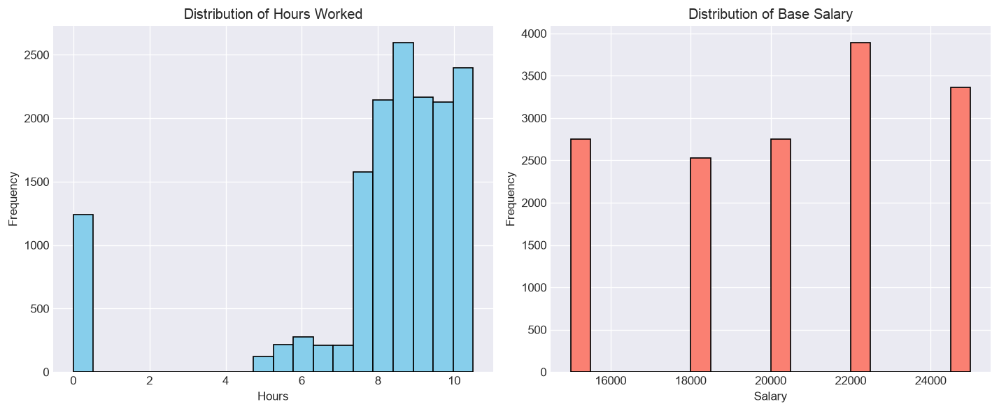
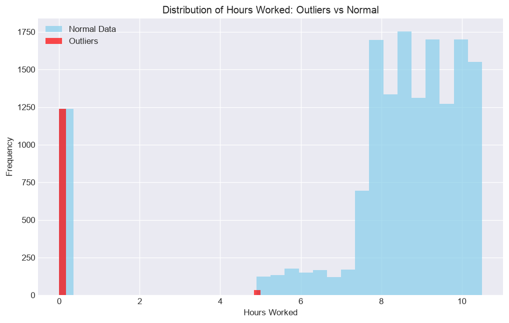
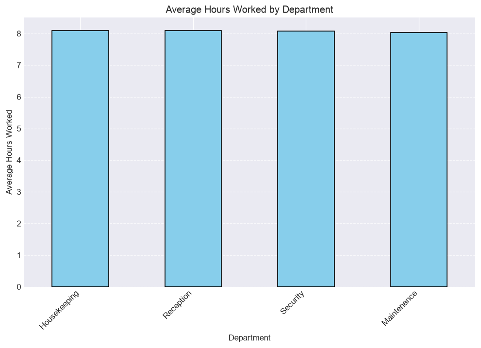
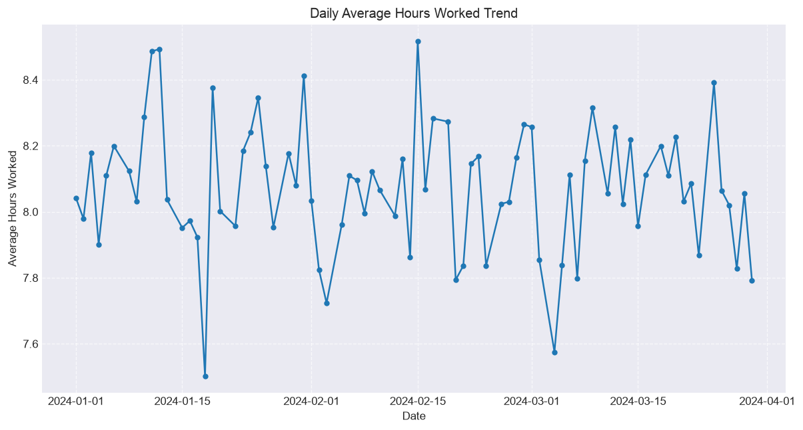
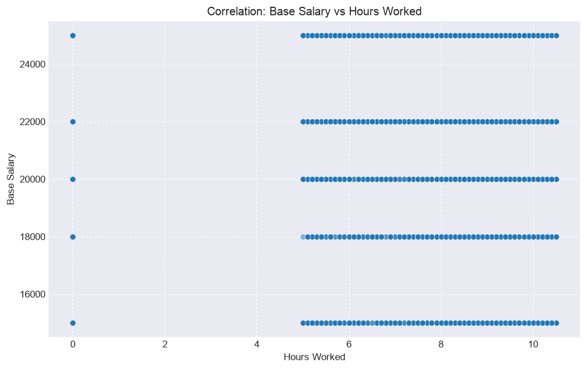

# 📊 Autonomous Data Analysis Report
**Dataset:** Attendance Data
**Generated:** 2026-07-20 14:20
**Agent:** Autonomous Data Analyst v1.0

---

## 🔍 Data Quality Assessment

| Metric | Value |
|--------|-------|
| Total Rows | 15600 |
| Total Columns | 12 |
| Duplicate Rows | 0 |
| Quality Score | **98.9/100** |

**Missing Values:**
- `punch_in`: 1268 missing
- `punch_out`: 1268 missing
- `hours_worked`: 312 missing
- `gps_location_match`: 1268 missing

**Outliers Detected In:** hours_worked (1271 outliers)

**Recommendations:**
- Column 'punch_in' has 1268 missing values (8.1%) — minor, monitor.
- Column 'punch_out' has 1268 missing values (8.1%) — minor, monitor.
- Column 'hours_worked' has 312 missing values (2.0%) — minor, monitor.
- Column 'gps_location_match' has 1268 missing values (8.1%) — minor, monitor.
- Outliers detected in: hours_worked (1271 outliers) — verify before trend analysis.

---

## 📈 Analysis Results

### 1. Descriptive Statistics of Attendance Metrics
*Type: descriptive | Confidence: 🟢 95%*

The analysis of 15,600 attendance records shows a mean of 8.07 hours worked per shift, with a median of 8.70 hours. The base salary data indicates a mean of $20,377.16 and a median of $20,000.00 across the workforce.

*Assumptions: The hours_worked field accurately reflects actual time on site.; The dataset represents a consistent period of time across all employees.; Zero-hour records represent scheduled shifts that were not completed rather than data entry errors.*

---

### 2. Outlier Detection in Hours Worked
*Type: outlier | Confidence: 🟢 95%*

The analysis identified 1,271 outliers in hours_worked, representing 8.31% of the 15,288 records analyzed. These outliers fall outside the 5.10 to 12.30-hour range, with a mean value of only 0.13 hours. The Maintenance department accounts for the highest volume of these anomalies with 431 instances, followed by Reception with 332.

*Assumptions: The 'hours_worked' field is calculated correctly by the source system.; Values near 0.13 hours are physically impossible for a standard work shift.; The outlier threshold of < 5.10 or > 12.30 hours is appropriate for identifying abnormal attendance patterns.*

---

### 3. Departmental Productivity Comparison
*Type: comparative | Confidence: 🟢 95%*

The analysis of 15,600 attendance records shows a high degree of consistency in average hours worked across departments, ranging from 8.04 hours in Maintenance to 8.10 hours in Housekeeping. The difference between the highest and lowest performing departments is only 0.06 hours per shift.

*Assumptions: Average hours worked is a valid proxy for departmental productivity.; The dataset represents a complete and accurate record of all employee shifts.; The 'hours_worked' field is calculated consistently across all departments.*

---

### 4. Daily Attendance Trend Analysis
*Type: trend | Confidence: 🟢 95%*

The average daily hours worked across the dataset is 8.07 hours. Daily attendance peaked on 2024-02-15 with an average of 8.52 hours, while the lowest attendance occurred on 2024-01-18 with an average of 7.50 hours.

*Assumptions: The 'hours_worked' column accurately reflects time on site without significant data entry errors.; The dataset represents a consistent workforce population across the analyzed period.; The 'date' column is correctly formatted and covers a representative sample of operational days.*

---

### 5. Correlation Between Salary and Hours
*Type: correlation | Confidence: 🟢 95%*

The correlation coefficient between base_salary and hours_worked is 0.0004 across 15,288 observations. This indicates there is effectively zero linear relationship between an employee's base salary and the number of hours they work.

*Assumptions: The hours_worked column accurately reflects total time spent on-site for all employees.; The base_salary column represents the full compensation package or is a consistent proxy for total pay.; The dataset contains no significant outliers that would skew the correlation calculation.*

---

## 💡 Key Business Insights

- **Descriptive Statistics of Attendance Metrics:** The gap between the mean and median hours worked suggests a right-skewed distribution caused by shifts with zero or very low hours; management should investigate the cause of these low-hour shifts to optimize labor utilization.
- **Outlier Detection in Hours Worked:** The extremely low mean of 0.13 hours suggests these outliers are primarily data entry errors or system logging failures rather than actual work shifts. I recommend auditing the time-tracking logs for the Maintenance and Reception departments to identify the root cause of these invalid entries.
- **Departmental Productivity Comparison:** Operational staffing levels are currently balanced across all departments, suggesting no immediate need for labor reallocation. Management should maintain current scheduling practices as there is no evidence of significant productivity variance.
- **Daily Attendance Trend Analysis:** The variance in daily hours suggests inconsistent shift coverage; management should investigate the root causes of the 12% drop in hours on 2024-01-18 to ensure operational stability.
- **Correlation Between Salary and Hours:** Compensation is currently decoupled from time spent on-site, suggesting that base salary structures are fixed regardless of individual output or attendance duration. Management should review whether this aligns with organizational goals or if a performance-based pay component is needed.

---

## ⏱️ Execution Timeline

| Time | Node | Action | Status |
|------|------|--------|--------|
| 2026-07-20 14:19:16 | data_ingestion | Rules preflight (12/12 rule files loaded) + profil | success |
| 2026-07-20 14:19:16 | planner | Generating analysis plan | success |
| 2026-07-20 14:19:30 | code_generator | Generating code for: Descriptive Statistics of Att | success |
| 2026-07-20 14:20:01 | executor | Executing: Descriptive Statistics of Attendance Me | success |
| 2026-07-20 14:20:08 | interpreter | Interpreting results: Descriptive Statistics of At | success |
| 2026-07-20 14:20:10 | code_generator | Generating code for: Outlier Detection in Hours Wo | success |
| 2026-07-20 14:20:13 | executor | Executing: Outlier Detection in Hours Worked (atte | success |
| 2026-07-20 14:20:17 | interpreter | Interpreting results: Outlier Detection in Hours W | success |
| 2026-07-20 14:20:19 | code_generator | Generating code for: Departmental Productivity Com | success |
| 2026-07-20 14:20:21 | executor | Executing: Departmental Productivity Comparison (a | success |
| 2026-07-20 14:20:25 | interpreter | Interpreting results: Departmental Productivity Co | success |
| 2026-07-20 14:20:27 | code_generator | Generating code for: Daily Attendance Trend Analys | success |
| 2026-07-20 14:20:30 | executor | Executing: Daily Attendance Trend Analysis (attemp | success |
| 2026-07-20 14:20:34 | interpreter | Interpreting results: Daily Attendance Trend Analy | success |
| 2026-07-20 14:20:37 | code_generator | Generating code for: Correlation Between Salary an | success |
| 2026-07-20 14:20:39 | executor | Executing: Correlation Between Salary and Hours (a | success |
| 2026-07-20 14:20:43 | interpreter | Interpreting results: Correlation Between Salary a | success |

---
*Generated by Autonomous Data Analyst Agent*
