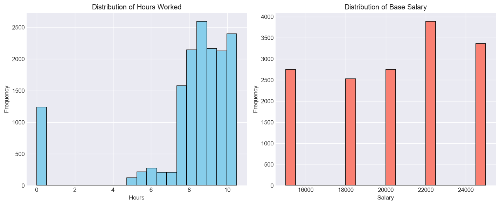
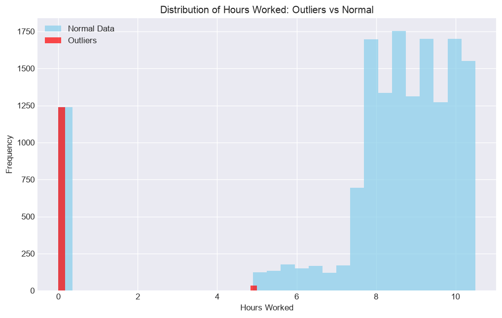
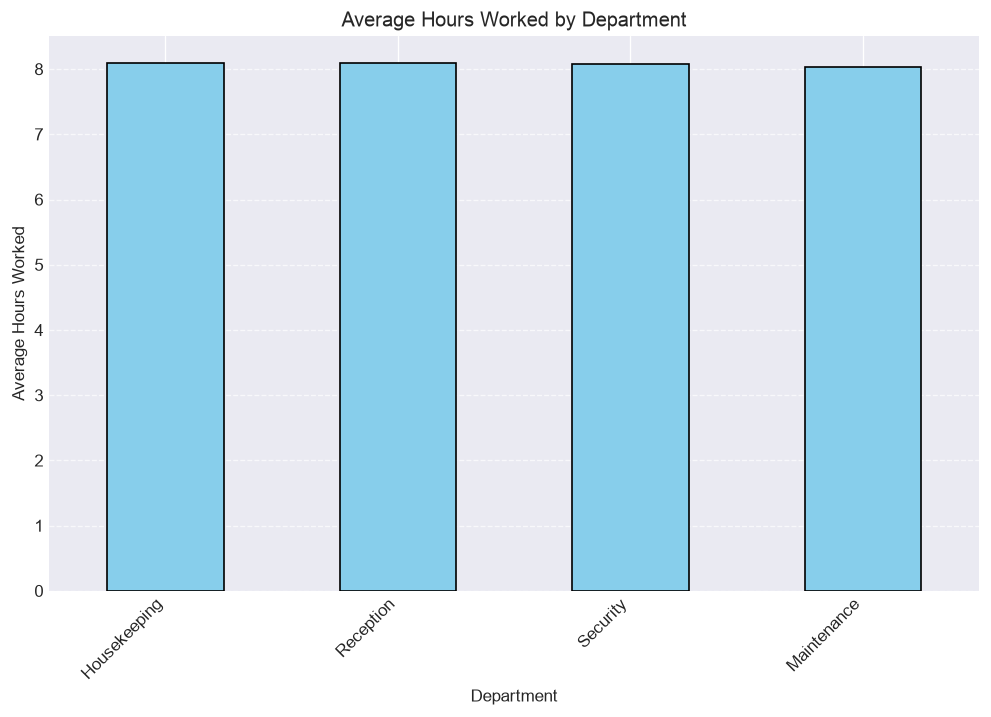
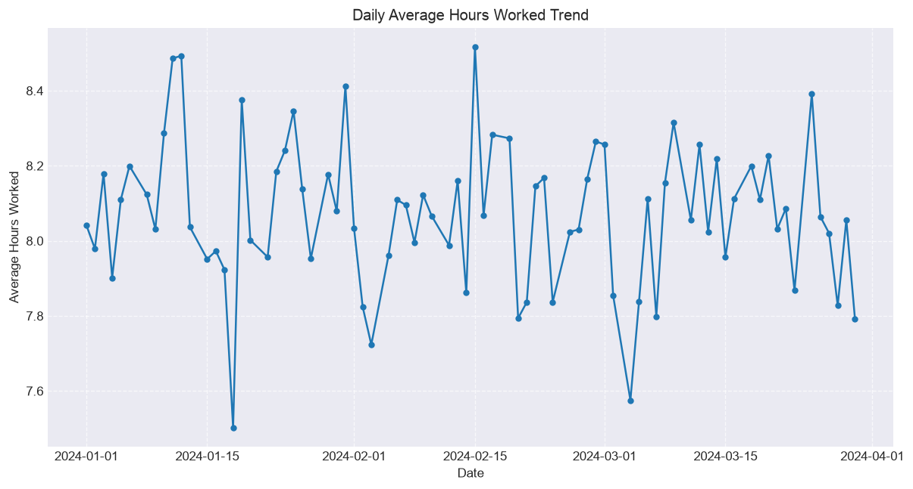
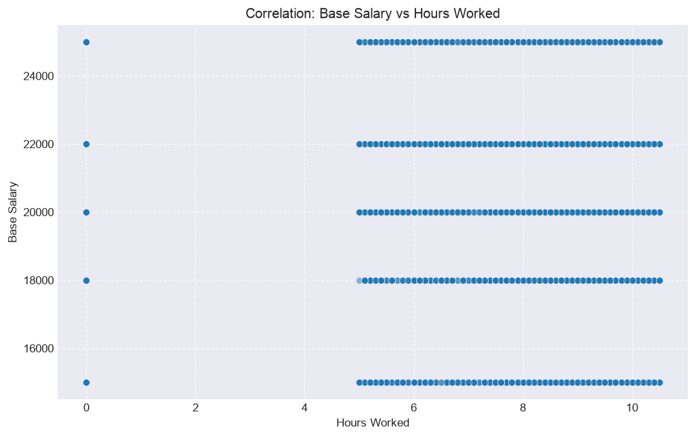

# 📊 Autonomous Data Analysis Report
**Dataset:** Sales Data
**Generated:** 2026-07-20 14:16
**Agent:** Autonomous Data Analyst v1.0

---

## 🔍 Data Quality Assessment

| Metric | Value |
|--------|-------|
| Total Rows | 293 |
| Total Columns | 12 |
| Duplicate Rows | 5 |
| Quality Score | **99.4/100** |

**Missing Values:**
- `sales_rep`: 3 missing
- `customer_satisfaction`: 6 missing

**Outliers Detected In:** units_sold (10 outliers), returns (15 outliers)

**Recommendations:**
- Remove 5 duplicate rows before analysis.
- Column 'sales_rep' has 3 missing values (1.0%) — minor, monitor.
- Column 'customer_satisfaction' has 6 missing values (2.0%) — minor, monitor.
- Outliers detected in: units_sold (10 outliers), returns (15 outliers) — verify before trend analysis.

---

## 📈 Analysis Results

### 1. Descriptive Statistics Overview
*Type: descriptive | Confidence: 🟢 95%*

The average sales amount per transaction is 46,327.40 with a median of 42,397.00, indicating a right-skewed distribution. Units sold average 142.72 per transaction, while customer satisfaction scores show a stable mean of 4.05 and a median of 4.10.

*Assumptions: The dataset represents a complete and representative sample of total sales activity.; The customer satisfaction scores are measured on a consistent scale across all entries.; The sales_amount and units_sold figures are recorded in a consistent currency and unit of measure.*

---

### 2. Sales Performance Trend Analysis
*Type: trend | Confidence: 🟢 95%*

Monthly sales peaked in May 2023 at $1,561,496, which is more than double the average monthly sales of approximately $848,370. There is a notable volatility in performance, with sales dropping from $1,561,496 in May 2023 to $706,310 in June 2023, and a significant single-month decline to $407,045 in March 2024.

*Assumptions: The provided monthly sales figures are accurate and reflect complete data for the specified periods.; The 'sales_amount' column represents gross revenue without accounting for returns.; The data is consistent across all regions and product lines.*

---

### 3. Correlation Analysis of Sales Drivers
*Type: correlation | Confidence: 🟢 95%*

The analysis shows a strong positive correlation of 0.843 between units sold and total sales amount, confirming that volume is the primary driver of revenue. Conversely, there is a negligible correlation between customer satisfaction and both sales amount (-0.002) and units sold (-0.057), indicating that current satisfaction scores do not track with sales performance.

*Assumptions: The customer_satisfaction data is representative of the broader customer base and not skewed by low response rates.; The correlation coefficient accurately captures the relationship between variables despite potential non-linear interactions.; The dataset provided is clean and free of significant outliers that could artificially deflate the correlation coefficients.*

---

### 4. Regional Performance Comparison
*Type: comparative | Confidence: 🟢 95%*

The North region leads in average sales at $52,750.92 per transaction, outperforming the South region, which has the lowest average sales at $40,081.79. However, the North region also reports the highest average returns at 7.23 units per transaction, compared to the South region's lowest return rate of 4.36 units.

*Assumptions: The average sales_amount and returns are calculated over the same time period for all regions.; The return values represent absolute unit counts rather than percentages of total sales.; Data quality is consistent across all regions with no significant missing values in the sales_amount or returns columns.*

---

### 5. Outlier Detection in Returns and Sales
*Type: outlier | Confidence: 🟢 85%*

The analysis identified 10 outliers in units_sold, all of which are associated with Product C, and 15 outliers in returns, with Rep_14 accounting for 3 of these instances. There is a strong positive correlation of 0.77 between units_sold and returns, suggesting that higher volume sales are consistently linked to higher return rates.

*Assumptions: The outlier detection method used standard statistical thresholds appropriate for this dataset distribution.; The identified outliers are not the result of systemic data entry errors but represent actual business transactions.; The correlation between units_sold and returns is linear and representative of the broader dataset.*

---

## 💡 Key Business Insights

- **Descriptive Statistics Overview:** The variance in sales suggests inconsistent performance across transactions; management should investigate the high-performing outliers to replicate successful sales strategies.
- **Sales Performance Trend Analysis:** The extreme variance in monthly revenue suggests unstable demand or inconsistent sales cycles; management should investigate the cause of the May 2023 spike to determine if it is repeatable or an anomaly. Additionally, the sharp drop in March 2024 warrants an immediate audit of sales operations for that period to identify potential reporting errors or external disruptions.
- **Correlation Analysis of Sales Drivers:** Since customer satisfaction metrics are not currently predictive of sales volume, management should investigate whether the satisfaction survey is capturing relevant customer sentiment or if other factors are driving purchasing decisions. Focus sales strategy on volume-driving initiatives rather than assuming current satisfaction levels are impacting revenue.
- **Regional Performance Comparison:** While the North region drives the highest revenue, the elevated return rate suggests a potential quality or expectation gap that warrants investigation. Management should audit the North region's sales process to determine if aggressive selling is inflating returns before scaling these practices elsewhere.
- **Outlier Detection in Returns and Sales:** The concentration of return outliers with Rep_14 and the high correlation between volume and returns suggest a need to audit the sales practices of Rep_14 and evaluate if Product C's high-volume sales process is driving excessive returns. Management should prioritize a performance review for Rep_14 and a quality control check for Product C.

---

## ⏱️ Execution Timeline

| Time | Node | Action | Status |
|------|------|--------|--------|
| 2026-07-20 14:14:38 | data_ingestion | Rules preflight (12/12 rule files loaded) + profil | success |
| 2026-07-20 14:14:38 | planner | Generating analysis plan | success |
| 2026-07-20 14:14:53 | code_generator | Generating code for: Descriptive Statistics Overvi | success |
| 2026-07-20 14:14:55 | executor | Executing: Descriptive Statistics Overview (attemp | success |
| 2026-07-20 14:15:02 | interpreter | Interpreting results: Descriptive Statistics Overv | success |
| 2026-07-20 14:15:04 | code_generator | Generating code for: Sales Performance Trend Analy | success |
| 2026-07-20 14:15:07 | executor | Executing: Sales Performance Trend Analysis (attem | success |
| 2026-07-20 14:15:12 | interpreter | Interpreting results: Sales Performance Trend Anal | success |
| 2026-07-20 14:15:19 | code_generator | Generating code for: Correlation Analysis of Sales | success |
| 2026-07-20 14:15:47 | executor | Executing: Correlation Analysis of Sales Drivers ( | success |
| 2026-07-20 14:15:53 | interpreter | Interpreting results: Correlation Analysis of Sale | success |
| 2026-07-20 14:16:05 | code_generator | Generating code for: Regional Performance Comparis | success |
| 2026-07-20 14:16:11 | executor | Executing: Regional Performance Comparison (attemp | success |
| 2026-07-20 14:16:15 | interpreter | Interpreting results: Regional Performance Compari | success |
| 2026-07-20 14:16:32 | code_generator | Generating code for: Outlier Detection in Returns  | success |
| 2026-07-20 14:16:35 | executor | Executing: Outlier Detection in Returns and Sales  | success |
| 2026-07-20 14:16:39 | interpreter | Interpreting results: Outlier Detection in Returns | success |

---
*Generated by Autonomous Data Analyst Agent*
